# Textura · 织理

单机优先的结构化执行工作台。它把 SOP、OKR、GTD、甘特图放在**同一个任务内核**上：
一条记录只存在一次，在六个视图里以不同形态出现。数据全部留在本机的一个 JSON 文件里。

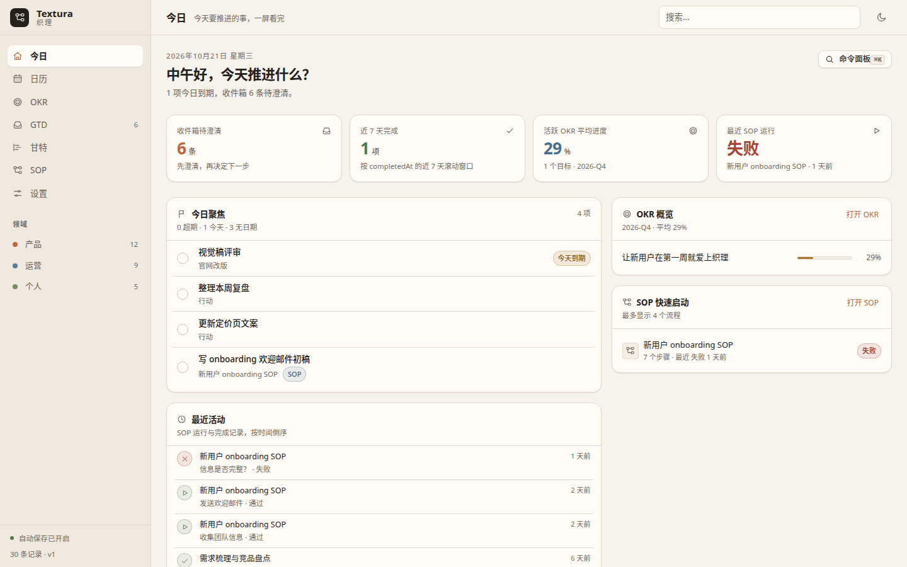

## 日历

公历与农历并排的日程视图：月视图是固定 6×7 网格（周一起始），格子里显示农历日、节日或节气，
日程用领域色圆点标出（超过 3 项显示 `+N`）；周视图按 7 列展开，跨天条目显示「第 n/m 天」。
右侧面板列出当天的条目，可直接勾完成、快速添加，或跳到甘特查看。

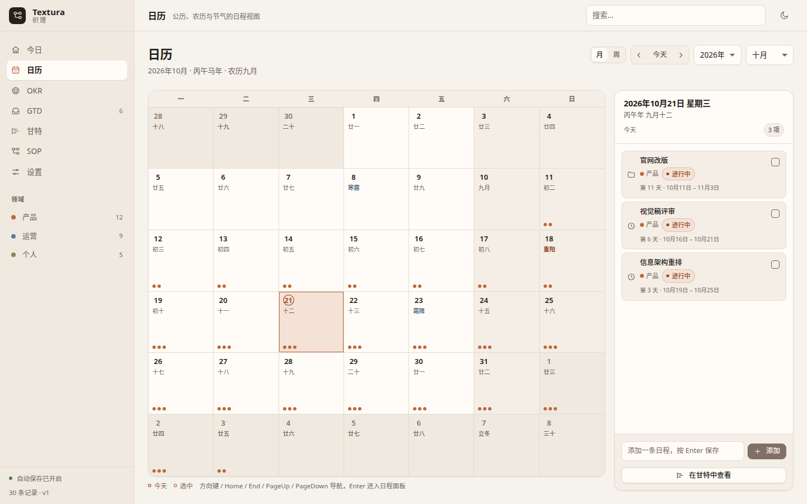

农历引擎零依赖自研：覆盖 1900-01-31 ～ 2100-12-31，支持闰月、干支 / 生肖、传统节日与 24 节气
（节气按太阳视黄经计算）；超出范围时只显示公历并给出提示。

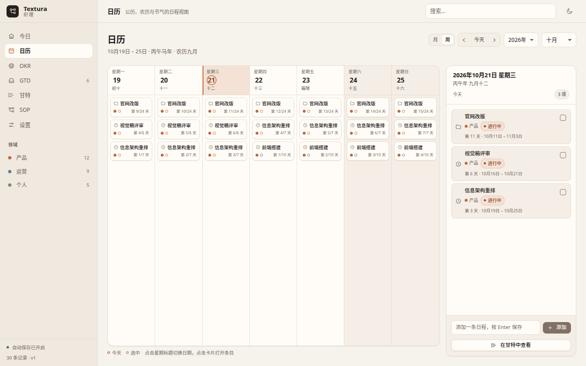

## 四个执行视图

### OKR —— 目标与关键结果的季度视图

用定性目标（O）配可量化关键结果（KR），指标带起点、当前值与目标值，季度内实时算出进度与「落后」KR。
KR 还能直接关联甘特 / GTD 里的项目与行动，目标与日常执行不断线。每张目标卡都能进入**独立编辑视图**
（卡片头部的「铅笔 + 编辑」按钮）：默认只读、点铅笔逐项编辑，同级 KR 同时只有一个编辑态，
`Esc` 先收编辑再返回列表，焦点回到原卡片。

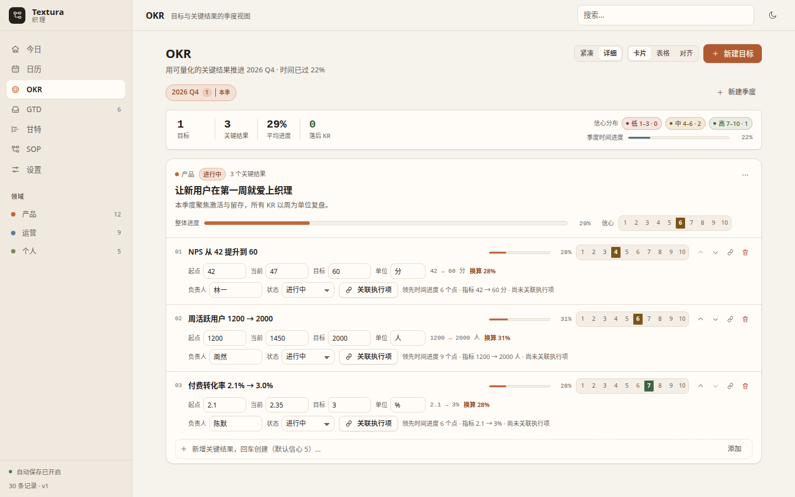

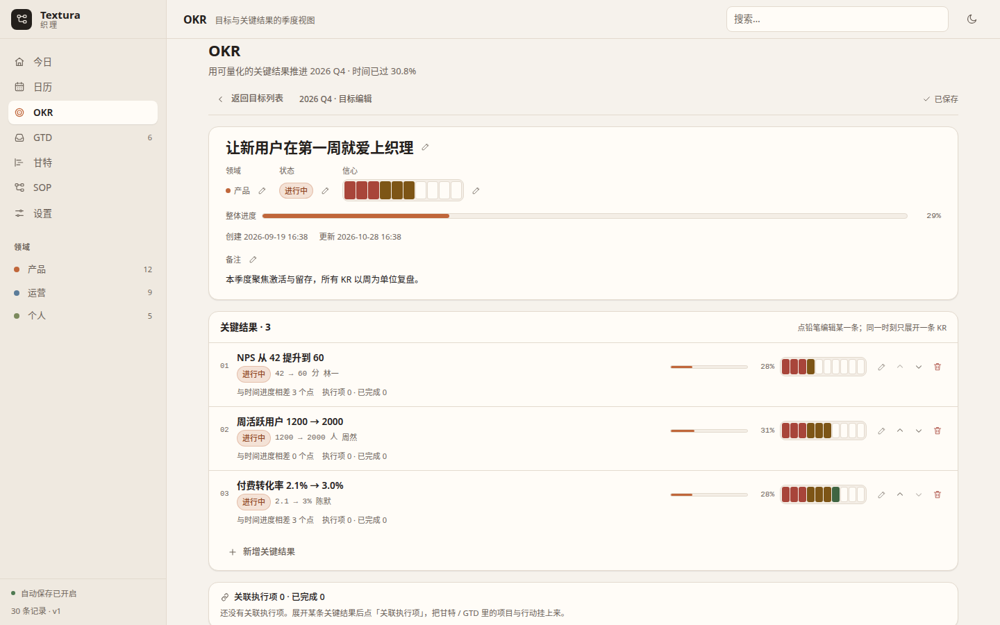

### GTD —— 收集、澄清、组织、回顾、执行

快速收集进收件箱，逐条澄清成下一步 / 项目 / 参考资料；下一步按场景分组，等待项带等待天数，
周回顾把收件箱清零度、停滞项目、超期任务一次列出。

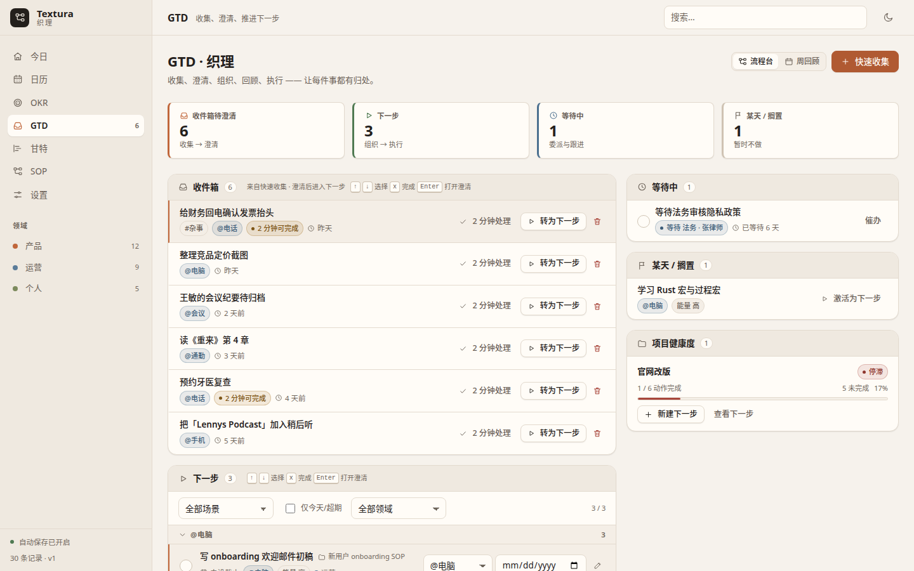

### 甘特 —— 时间轴上的承诺与依赖

按项目分组的两级时间轴，日 / 周 / 月三种缩放，任务条可拖动改期、拖边缘改工期（吸附到天），
依赖用折线箭头绘制。

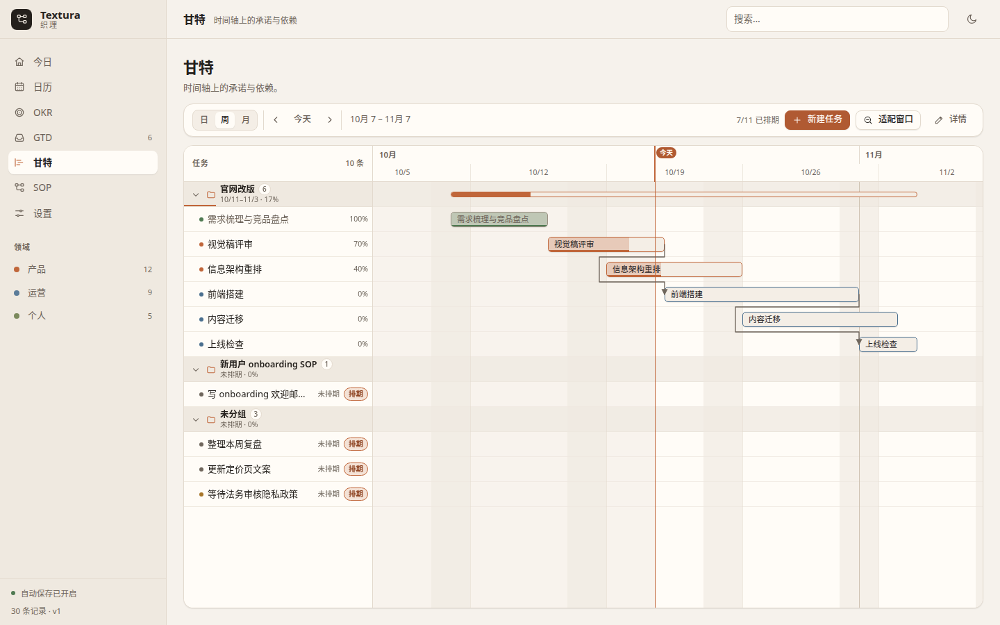

### SOP —— 把流程画成可执行的图

节点是步骤、连线决定下一步；支持自动布局、检查项、分支标签，并能进入运行模式逐步记录通过 / 未通过 / 跳过。

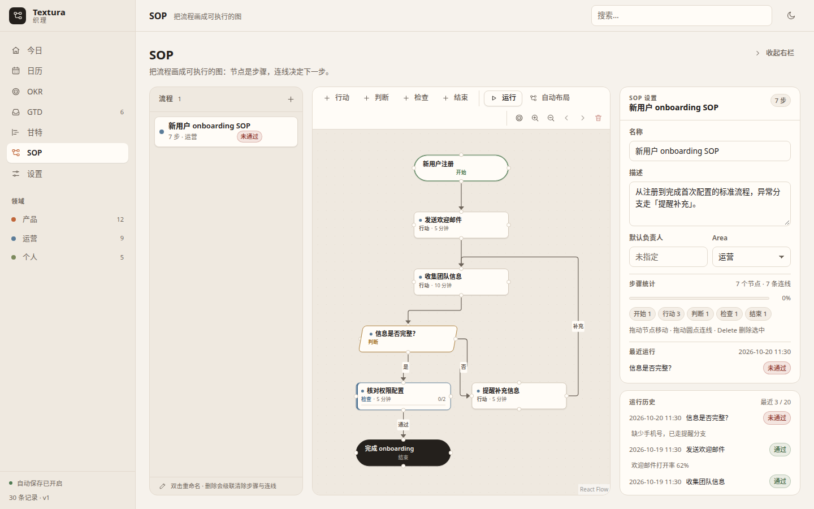

## 为什么不是四个独立工具

四个独立工具最贵的地方不是订阅费，而是**同一件事要在四个地方各记一遍**：季度目标一套清单、
下一步一个待办应用、排期一张表格、流程一份文档，任何一处改了，其余三处立刻过期。

Textura 只有一个 `Item` 实体，每个视图只是读取它的不同数据块：

```ts
// src/core/model.ts（节选，注释为附加说明）
export interface Item {
  id: string;
  kind: ItemKind;            // objective | keyresult | project | action | sop | step | milestone | note | reference
  title: string;
  notes: string;
  parentId: string | null;   // 树结构：O → KR，项目 → 行动，SOP → 步骤
  order: number;
  status: ItemStatus;        // inbox | next | active | waiting | scheduled | someday | done | dropped
  tags: string[];
  areaId: string | null;     // 领域：产品 / 运营 / 个人 …
  createdAt: string;
  updatedAt: string;
  completedAt: string | null;
  okr?: OkrData;             // period / confidence / metric{ start, target, current, unit } / krOwner
  gtd?: GtdData;             // capturedAt / clarified / context / energy / waitingFor / twoMinuteCandidate
  gantt?: GanttData;         // start / end / progress
  sop?: SopData;             // nodeType / canvas{ x, y } / checklist / owner / durationMin
}
```

这带来的实际差别：

- **改一处，四处同步**。在 GTD 里勾掉「前端搭建」：今日的「近 7 天完成」+1，甘特条立刻显示 100%，
  「官网改版」项目的完成比随之上升——三个视图读的是同一个 `status` 与 `completedAt`。
- **一个行动可以同时是甘特条、GTD 下一步和 KR 的执行项**。KR 通过 `okr` 边关联项目 / 行动，
  不复制标题、不建第二份任务，进度永远来自同一份数据。
- **SOP 的步骤也是任务**。步骤节点就是 `kind: 'step'` 的条目，有状态、有负责人、有检查项，
  运行记录写进同一份工作区，所以「今天做了什么」只需要看一处。
- **导入 / 导出 / 备份都只有一种格式**：一份 `workspace.json`，包含 items / edges / areas / runs。

## 功能一览

**今日**

- 四张状态卡：收件箱待澄清、近 7 天完成、当前季度 OKR 平均进度、最近 SOP 运行结果。
- 今日聚焦：超期 → 今日到期 → 无日期下一步，按此顺序合并去重，行内可直接勾完成。
- 目标概览（当前季度，逐条进度条）、SOP 快速启动（最多 4 个，含最近运行结果）。
- 最近活动：SOP 运行记录 + 最近完成条目，按时间倒序。
- 空工作区引导：去 GTD 收集 / 创建第一个目标 / 创建第一个 SOP（收集入口统一在 GTD）。

**日历**

- 月视图：固定 6×7、周一起始，农历日 / 节日 / 节气标签，今天圆环、选中描边，日程圆点 + `+N`。
- 周视图：周一到周日 7 列，跨天条目显示「第 n/m 天」，点星期标题切换当天、点卡片打开条目。
- 右侧当日面板：农历全称、节日 / 节气 Badge、完成勾选、快速添加（回车保存）、「在甘特中查看」。
- 年 / 月选择（1900–2100）与「上一段 / 今天 / 下一段」；方向键、Home / End、PageUp / PageDown 导航。
- 深链 `?route=calendar`（可带 `?item=<id>` 直接选中条目）。

**OKR**

- 季度切换与新建季度；目标可移动到其他季度、复制为新季度目标（KR 当前值重置为起点）。
- 卡片 / 表格 / 对齐三种视图，卡片可切紧凑 / 详细两种密度。
- KR 指标（起点 / 当前 / 目标 / 单位）与 1–10 信心指数在目标编辑视图里修改。
- 季度健康度：目标数、KR 数、平均进度、落后 KR 数、信心分布、季度时间进度。
- 关联执行项：从甘特 / GTD 挑选项目与行动挂到 KR 上，可解除关联。
- 列表卡片只读：不渲染输入控件，标题 / 指标 / 负责人 / 信心只显示，编辑集中在目标编辑视图。
- 目标编辑视图：卡片头部的「铅笔 + 编辑」按钮进入独立页面式编辑（Hero、完整 KR 行、执行项概览、移动 / 复制 / 删除）；
  视图默认只读，点铅笔逐项编辑，同级 KR 同时只有一个编辑态，`Esc` 先收编辑再返回并把焦点还给卡片。

**GTD**

- 收件箱（按收集时间倒序）、下一步（按场景分组 + 场景 / 领域筛选 + 「仅今天/超期」）、
  等待中（等待天数，超 7 天提醒）、某天 / 搁置、项目健康度（停滞项目识别）。
- 澄清表单：类型、标题、备注、场景（预设 / 自定义）、能量、截止日期、领域、标签、
  委派等待、某天搁置、2 分钟规则。
- 周回顾：窗口为今天往前 7 天，收件箱清零进度、本周完成、超期、停滞项目、
  等待超 7 天、无日期任务、14 天未动的领域，可逐卡标记「已回顾」。

**甘特**

- 日 / 周 / 月三种缩放（40 / 28 / 12 px 每天），拖拽吸附到天，可拖整体或拖左右边缘改工期。
- 左右两栏联动滚动，分组可折叠，未分组条目单独成组；「今天」「适配窗口」「上一段 / 下一段」导航。
- 详情面板：标题、备注、状态、领域、起止日期、进度滑杆、依赖增删、子任务勾选。
- 依赖箭头自动绕开中间任务条；已完成条目进度恒按 100% 显示。

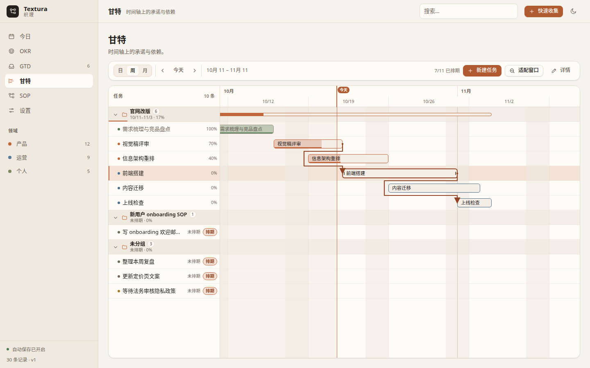

**SOP**

- 流程列表（新建 / 重命名 / 删除，显示步骤数与最近运行结果）。
- 画布：新增 行动 / 判断 / 检查 / 结束 节点，拖拽连线，dagre 自动布局（TB），缩放与「适应画布」。
- 检查器：节点标题、说明、类型、负责人、预计时长、检查项清单；连线标签（是 / 否 / 通过 / 补充 / 继续）。
- 运行模式：从开始节点逐步执行，通过 / 未通过 / 跳过，多出边时选择分支，结束后写入运行历史。

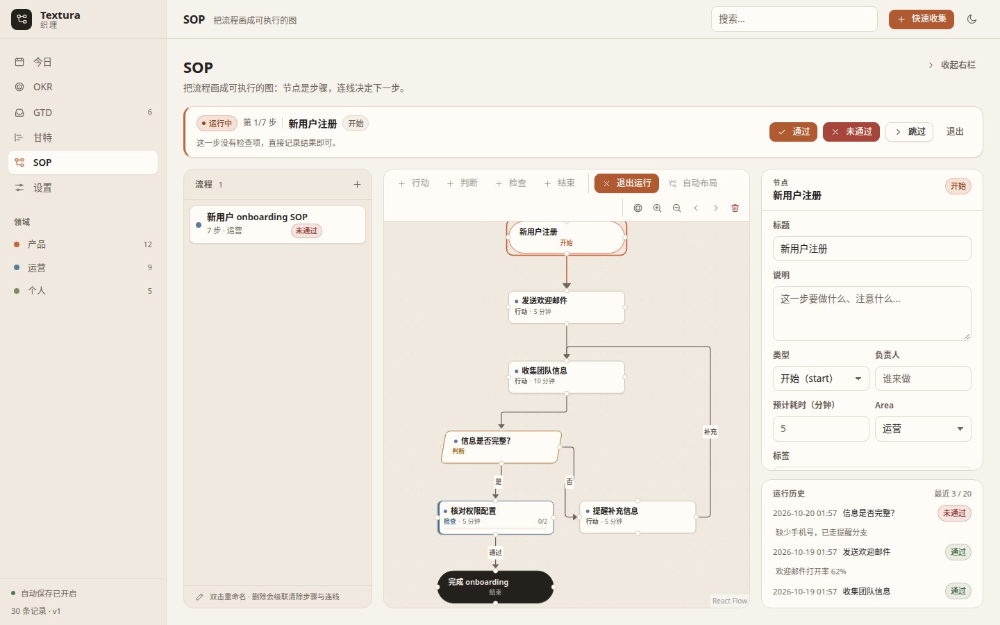

**应用级**

- 命令面板（`Ctrl/Cmd + K`）：命令、条目、领域统一搜索，带「最近使用」。
- 快速收集：GTD 收件箱的收集入口（GTD 页头「快速收集」按钮，弹窗标题为「收集到 GTD 收件箱」），
  外加全局快捷键 `Ctrl/Cmd + N` 与命令面板命令；`#标签`、`@场景`、`!高能 / !低能`、
  `/今天 /明天 /本周` 语法，连续录入与单条撤销。
- 设置页：主题切换、存储路径与备份列表（恢复备份）、导入 / 导出 JSON、撤销 / 重做、重置为演示数据。
- 快捷键帮助（`?`）、深色主题、视图深链（`?route=calendar`、`?route=okr&item=<id>`）与视图记忆。
- 数据保护：导入时拒绝父子环并给出环路径；加载时自动切断环、另存修复副本且不覆盖原文件；
  工作区版本高于当前应用时拒绝加载并保留副本；非法字段自动归一化，失效枚举回落并提示「已修正 N 处非法数据」。
- 批量撤销：SOP 的拖拽 / 自动布局、OKR 的跨季度移动都走一次批量写入，一次手势或一条命令只产生一条历史，
  `Ctrl/Cmd + Z` 一次整体回退。
- 视图渲染错误边界：任一视图崩溃时显示可读的兜底页（返回今日 / 保存并重新加载 / 查看数据目录），外壳不白屏。

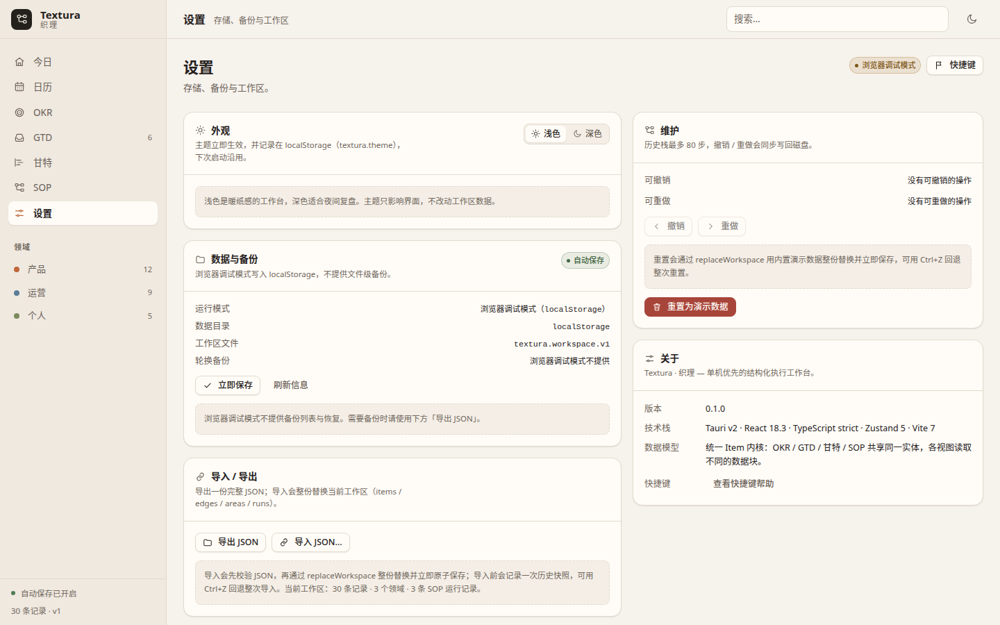

## 技术栈与架构

Tauri v2（Rust 侧负责单文档原子写 + 30 份轮换备份）+ React 18.3 + TypeScript strict + Zustand 5 + Vite 7；
SOP 画布用 `@xyflow/react` 12 + `@dagrejs/dagre`，甘特为手写实现，日历的农历 / 节气引擎零依赖自研，
其余日期计算统一走 `date-fns` 4。
没有路由库、没有 UI 组件库、没有 CSS 框架。生产构建启用 CSP（`script-src 'self'`，主题预置外置为
`public/theme-init.js`），视图层有错误边界兜底；路由级 `React.lazy` + `manualChunks`（react / flow / date）
把首屏 JS 压到 84.4 KiB gzip。

分层、数据流、设计取舍与扩展方式见 [ARCHITECTURE.md](ARCHITECTURE.md)；
操作步骤见 [USER-GUIDE.md](USER-GUIDE.md)；开发契约见 [docs/contract.md](docs/contract.md)。

## 性能（10k 实测）

生产构建 + **10,000 条目 / 3.23 MB** 工作区，无头 Chrome 1440×900，脚本 `scripts/qa/perf-bench.mjs`：

| 指标 | 实测 |
| --- | --- |
| 首屏 JS | 4 个请求，**262.1 KiB raw / 84.4 KiB gzip**（优化前 679 KiB / 219 kB，**−61%**）；构建无 >500 kB 警告 |
| 首屏 FCP | 256 ms |
| 路由切换（中位） | 今日 62 / 日历 58 / 甘特 108 / SOP 103 / OKR 295 / GTD 311 ms（首次切换额外 +100–210 ms 加载 chunk） |
| 编辑 | GTD 完成 45 / OKR 指标 21 / 甘特拖拽 63 ms |
| 撤销 | 18–38 ms |
| 内存 | 100 次编辑堆净增 **7.5 MB**（结构共享历史） |
| DOM | 甘特树 28 行（4,001 行数据、2,001 条已排期）；SOP 28 节点（300 step / 400 边）；GTD 下一步 100 行（1,500 条） |

实现手段：索引化选择器（`WeakMap` + `Object.freeze`）、结构共享历史（不再整份深拷贝）、
甘特树 / 表头与 SOP 画布的视口级渲染、GTD / 今日 / OKR 列表分页、路由级 `React.lazy` + `manualChunks`。
细节与残余边界见 [ARCHITECTURE.md](ARCHITECTURE.md) §7。

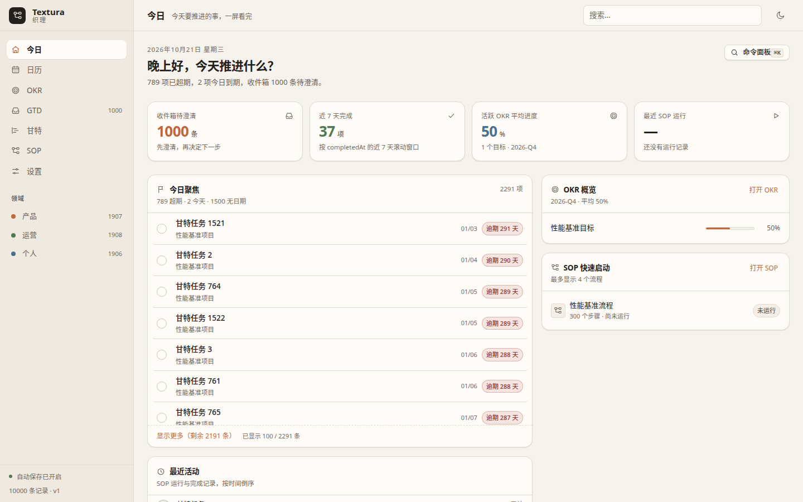

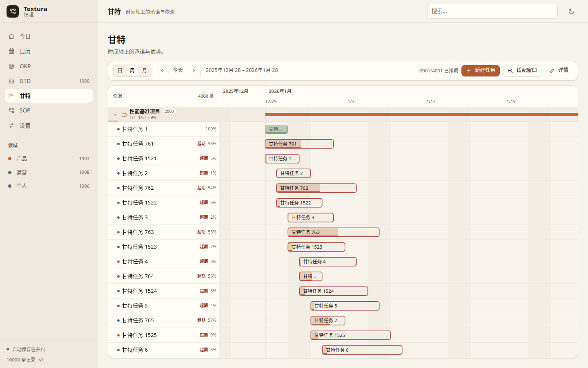

分页规则：GTD 收件箱 / 下一步 / 等待 / 某天与今日聚焦每页 **100** 条，OKR 表格每页 **200** 条 KR，
底部「显示更多（剩余 N 条）」追加；切换筛选、搜索、季度或折叠分组会回到第一页。
首次进入某个懒加载视图时会显示「正在织理「视图名」…」骨架。

## 快速开始

环境要求：

- **Node.js 20.19+ 或 22.12+**（Vite 7 的 engines 要求）
- **Rust 1.77.2+**（`src-tauri/Cargo.toml` 的 `rust-version`）
- **Linux 系统依赖**（Ubuntu / Debian，Tauri v2 官方列表）：

  ```bash
  sudo apt install build-essential curl wget file libssl-dev \
      libwebkit2gtk-4.1-dev libgtk-3-dev libxdo-dev \
      libayatana-appindicator3-dev librsvg2-dev
  ```

```bash
npm install          # 安装前端依赖
npm run dev          # 浏览器调试模式：http://localhost:1420
npm run tauri dev    # 桌面开发模式（同时起 Vite 与 Tauri 窗口）
npm test             # vitest 单测
npm run tauri:build  # 构建 deb 安装包
```

首次启动（**首次安装**且工作区为空）会自动写入一份演示数据：3 个领域、1 个目标 + 3 个 KR、
1 个 7 步 SOP、1 个「官网改版」项目 + 6 个行动、6 条收件箱等。主文件 / `.bak` / 轮换备份任已存在时不再播种，
所以导入空工作区后重启会保持为空。清理演示数据的方式见 USER-GUIDE 的「数据安全与保护」章节。

视图可以直接深链：`?route=calendar`、`?route=okr`、`?route=gtd&item=<id>` 等
（合法路由：`dashboard` / `calendar` / `okr` / `gtd` / `gantt` / `sop` / `settings`）。

## 安装包

`npm run tauri:build`（即 `tauri build --bundles deb`）产出：

```bash
src-tauri/target/release/bundle/deb/Textura_0.1.0_amd64.deb
```

安装与卸载：

```bash
sudo dpkg -i src-tauri/target/release/bundle/deb/Textura_0.1.0_amd64.deb
sudo dpkg -r textura     # 卸载（不会删除数据目录）
```

## 数据与隐私

- 全部数据在本机：桌面模式写入 `app_data_dir/workspace.json`
  （Linux 下通常为 `~/.local/share/app.textura.desktop/workspace.json`），实际路径可在
  设置 → 数据与备份 中查看。
- 写入方式：`workspace.json.tmp` → `fsync` → `rename` 覆盖，写前把旧文件复制为 `workspace.json.bak`；
  每次成功保存还会在 `backups/` 下生成 `textura-YYYYMMDD-HHmmss.json`，**只保留最新 30 份**。
- 读取顺序：`workspace.json` → `workspace.json.bak` → 最新轮换备份 → 空工作区，解析失败自动降级。
  整个读取 / 写入临界区由 Rust 侧串行化（`spawn_blocking` + 保存锁），并发保存不会交错。
- 加载时发现问题不会静默丢数据：父子环会被切断并另存 `workspace.repaired-<时间戳>.json`（不覆盖原文件）；
  工作区版本高于当前应用时拒绝加载，并把原文件复制为 `workspace.future-v<N>.json`；
  非法字段（越界数值、未知枚举）归一化后一次性提示「已修正 N 处非法数据」。
- 应用启用 CSP：`default-src 'self'`、`script-src 'self'`、`frame-ancestors 'none'`，
  只有 Tauri IPC 与内联样式被放行；磁盘读写在 Rust 侧完成，WebView 不直接访问文件系统。
- 前端代码里没有任何网络请求、没有遥测、没有账号体系；唯一的外部交互是系统文件对话框
  （导出 / 导入 JSON）。
- 浏览器调试模式（`npm run dev`）不落文件，改写 `localStorage['textura.workspace.v1']`。

## 已知限制

1. **单机单文档**：没有云同步、没有多端协作、没有并发编辑保护（同时开两个进程仍会互相覆盖）。
2. **甘特不做依赖约束**：添加依赖时只拦住完全相同的重复边，A→B→A 这类环仍可建立；依赖线只负责画出来，
   不会重排日期；子任务拖出父级区间只提示「仍按拖拽结果保存」，不自动裁剪；拖到视口边缘不会自动滚屏。
3. **SOP 连线进出点不持久化**：`Edge` 模型没有 handle 字段，左右 / 上下进出点按节点当前位置推导，
   拖动节点后连线走向可能变化。
4. **GTD 的归档借用 `done` 状态**：模型没有独立归档字段，「参考资料 / 笔记」澄清后状态置为 done，
   因此会出现在「本周完成」等完成类统计中。
5. **大工作区**：10,000 条（3.23 MB）已实测可用（FCP 256 ms、编辑 21–63 ms），但超过这个量级仍建议按领域 /
   季度分片存储或换 SQLite；每次保存仍是整份序列化 + `.bak` + 轮换副本，写放大会随条目数线性增长。
6. **保存的主线程成本**：浏览器调试模式整份 3.2 MB 序列化会产生一次约 **135 ms** 长任务；
   桌面端磁盘 IO 走 `spawn_blocking`，但序列化仍在主线程。构建 `sourcemap: false`，线上排错需另想办法。
7. **路由懒加载**：首屏只加载入口 / `react` / `date` 三个 chunk，首次进入某个视图会有一次 chunk 加载
   （实测额外 100–210 ms），期间显示「正在织理「视图名」…」骨架。
8. **诊断副本与署名**：`workspace.repaired-*.json` 不参与 30 份轮换、不会被自动清理；
   `@xyflow/react` 默认署名水印保留（移除需商业授权）。
9. **验证边界**：真实 Tauri 窗口、自动保存、CSP 与 IPC 已在 Xvfb 下实机验证（`scripts/tauri-smoke.sh`），
   仅原生系统文件对话框（导出 / 导入的路径选择）未做端到端点击验证。
10. **农历范围**：只覆盖 1900-01-31 ～ 2100-12-31，范围外只显示公历并提示；年 / 月选择器同样限定 1900–2100。
11. **节气精度**：节气按太阳视黄经计算（分钟级），极少数交节时刻落在午夜前后的年份，与前一日历可能相差一天。
12. **日历视图状态不跨刷新保留**：视图（月 / 周）与当前选中日期只记在模块内存里，切换视图再回来会保留，
    刷新或重启后回到月视图 + 今天。
13. **窄屏抽屉为覆盖式**：≤1180px 时当日面板变成底部覆盖抽屉，会遮住网格下半部分，不是挤压布局。

## 测试

```bash
npm test                                        # 27 个测试文件 / 352 个用例（vitest run）
cargo test --manifest-path src-tauri/Cargo.toml  # Rust 持久化测试，13 个用例
```

前端单测覆盖：模型归一化与环检测（`repo.test.ts`）、store 的 `updateItems` 批量写入与历史、
selectors 树查询、甘特几何 / 吸附 / 虚拟化窗口（`gantt/virtual.test.ts`）、GTD 逻辑与列表分页、
OKR 指标换算与表格分页、SOP 布局 / 适配 / 运行推进 / 节点对象复用（`sop/perf.test.ts`）、
命令面板模糊匹配、快速收集语法、导入校验、设计令牌对比度（`tokens.test.ts`），
以及日历的农历引擎（`calendar/lunar.test.ts`，48 例）与日历逻辑（`calendar/calendarLogic.test.ts`，35 例）；
`core/indexing.test.ts` 用 `deepFreeze` 守护「工作区与 Item 不可原地修改」并给出 10k 规模预算断言。

`cargo test` 覆盖（13 个用例）：round-trip 与 `.bak` 生成、主文件损坏回退、全部损坏回退空库、
30 份备份轮换与恢复、低版本迁移、备份名路径穿越拒绝、导出（缩进 2 空格）与导入、`freshInstall` 判定、
未来版本拒绝与副本保留、并发保存串行化、锁中毒恢复、环修复副本不触碰主文件、非法字段反序列化拒绝。

浏览器端集成冒烟由 `scripts/qa/` 下的脚本用无头 Chrome + CDP 驱动（不依赖第三方包）：

```bash
# 终端 A：起一个独立的预览服务（脚本默认连 1430 端口）
npx vite --port 1430 --strictPort

# 终端 B：逐个运行（需要 Node 22+ 与 /usr/bin/google-chrome）
node scripts/qa/collector-selftest.mjs   # 自检：确认控制台 / 异常收集器真的在工作
node scripts/qa/smoke.mjs                # 14 张截图（7 主图 + 7 补充）+ 布局溢出 + 控制台错误
node scripts/qa/overlays.mjs             # 逐个打开弹层（收集、命令面板、澄清、导入…）
node scripts/qa/secondary-views.mjs      # OKR 三视图 / GTD 两视图 / 甘特详情 / SOP 切换
node scripts/qa/flows.mjs                # 8 条跨模块流程（收集→澄清、拖拽持久化、主题、导出…）
node scripts/qa/regression.mjs           # 第二轮修复回归（甘特进度口径 / 页头、SOP 视口、导入撤销、深色对比度）
node scripts/qa/final-regression.mjs     # 终验复核：含环加载、未来版本拒绝、空库导入后保持为空、批量撤销、归一化
node scripts/qa/calendar-acceptance.mjs  # 日历 + 快速收集归属 + OKR 页头验收（月/周、农历标签、深链、面板行为）
node scripts/qa/calendar-1024.mjs        # 窄屏日历截图（calendar-1024）与宽屏构图对照
node scripts/qa/final-fixes.mjs          # P2 回归：通知浮层不吞点击、≤1180px 点日期自动展开且尊重手动收起
node scripts/qa/perf-bench.mjs           # 生产构建 + 10k 数据基准（首屏 / 路由 / 编辑 / 撤销 / 内存 / DOM）
node scripts/qa/perf-regression.mjs      # 性能改造后的功能回归（7 路由 + 收集 / OKR / 甘特 / SOP / 日历 / 撤销）
node scripts/qa/perf-shots.mjs           # 性能证据截图（perf-10k-dashboard / perf-gantt-2k）
```

性能基准的前置步骤（结果写到 `/tmp/textura-perf/`，不入库）：

```bash
npm run build
node scripts/qa/perf/generate-workspace.mjs          # 生成 10,000 条工作区
(cd dist && python3 -m http.server 4180 --bind 127.0.0.1)
node scripts/qa/perf-bench.mjs                       # 需要 Node 22+ 与 /usr/bin/google-chrome
```

截图共 **17 张**，写入 `docs/screenshots/`：

- **7 张主图**：`dashboard` / `calendar` / `okr` / `gtd` / `gantt` / `sop` / `settings`；
- **8 张补充**：`dashboard-1024`、`gantt-1024`、`calendar-1024`、`dashboard-dark`、`calendar-dark`、
  `calendar-week`、`sop-run`、`gantt-deps`；
- **2 张性能证据**：`perf-10k-dashboard`（10k 数据下的今日视图）、`perf-gantt-2k`（2,001 条已排期时的甘特 DOM 虚拟化）。

报告写入 `docs/screenshots/smoke-report.json`、`docs/screenshots/flows-report.json` 与
`docs/screenshots/perf-regression/regression-report.json`；可用 `TEXTURA_BASE_URL`、`PERF_BASE_URL`
与 `CHROME_BIN` 覆盖默认值。

真实窗口冒烟（Xvfb + 截图 + 文件断言）：

```bash
npm run build && npm run tauri:build -- --bundles deb
bash scripts/tauri-smoke.sh    # 需要 xvfb-run / import / identify / node / python3
```

脚本在隔离的 `HOME` 下启动 release 二进制，截图并校验非空白，断言工作区 `items=30`、`areas=3`、
自动保存后 `.bak` 保留中间态（31 条）与至少 2 份轮换备份，并扫描 stderr 中的 CSP / IPC 错误。
启动期的数据保护（首次播种、含环文件、未来版本、空工作区保持为空）另由
`bash scripts/qa/app-boot.sh <label> [workspace.json]` 用同样的方式验证。

设计令牌对比度可单独审计：

```bash
node scripts/contrast-audit.mjs
```

## 目录结构

```
Textura/
├── docs/
│   ├── contract.md            开发契约：模型、store、selectors、UI 原语、持久化与安全、所有权规则
│   └── screenshots/           截图与 QA 报告（flows/ 跨模块流程终态，final-regression/ 终验证据）
├── public/
│   └── theme-init.js          首屏前应用已保存主题（外置脚本，生产 CSP 不需要内联许可）
├── scripts/
│   ├── make_icon.py           生成应用图标
│   ├── contrast-audit.mjs     设计令牌 WCAG 对比度审计（可单独运行）
│   ├── tauri-smoke.sh         真实 Tauri 窗口冒烟（Xvfb + 截图 + 文件断言 + CSP/IPC 检查）
│   └── qa/                    无头 Chrome 集成冒烟脚本（lib.mjs 为 CDP 客户端，app-boot.sh 为启动期验证；
│                              calendar-acceptance / final-fixes 为日历与入口验收，perf-* 为性能基准与回归）
├── src/
│   ├── app/                   应用外壳：AppShell 路由分发、Sidebar、TopBar、routes、RouteErrorBoundary、RouteLoading
│   ├── core/                  统一任务内核（模块只读）
│   │   ├── model.ts           Item / Edge / Area / SopRunEntry / Workspace 与枚举
│   │   ├── store.ts           唯一 Zustand store：写操作、批量写入、结构共享历史、防抖保存、replaceWorkspace
│   │   ├── selectors.ts       索引化选择器：WeakMap 索引 + freeze、树遍历、环检测、进度与排期查询
│   │   ├── repo.ts            持久化适配层与归一化：Tauri invoke ↔ localStorage 降级、环/版本处理
│   │   ├── routeState.ts      深链 ?route= / ?item= 与视图记忆
│   │   ├── fixtures.ts        演示数据
│   │   ├── history.ts         undo / redo 栈（引用快照，上限 80）
│   │   └── utils.ts           日期键、防抖器、调色板等工具
│   ├── modules/
│   │   ├── appshell/          应用级界面：命令面板、快速收集、设置页、快捷键帮助、导入导出
│   │   ├── dashboard/         今日视图：聚焦列表（100 条/页）、状态卡、目标 / SOP 概览、活动流
│   │   ├── calendar/          日历视图：月份 / 周视图、当日面板、农历引擎与日历逻辑
│   │   │   ├── lunar.ts       零依赖农历 / 24 节气引擎（1900–2100，lunarInfo 表 + 太阳视黄经）
│   │   │   ├── calendarLogic.ts 6×7 网格、周区间、按日分桶、标签优先级、窄屏展开规则
│   │   │   └── MonthGrid / WeekView / DayPanel / CalendarToolbar / itemDisplay
│   │   ├── okr/               OKR 视图：季度条、卡片 / 表格（200 条 KR/页）/ 对齐、指标草稿与信心
│   │   ├── gtd/               GTD 视图：收件箱、下一步、等待、某天（均 100 条/页）、澄清、周回顾
│   │   ├── gantt/             甘特视图：scale.ts（几何与吸附）、virtual.ts（行 / 列窗口）、时间轴、左侧树、依赖
│   │   └── sop/                SOP 视图：画布（视口渲染）、perf.ts（节点对象复用）、检查器、运行、布局
│   ├── styles/                设计令牌 tokens.css、基础排版 base.css、外壳 shell.css
│   ├── ui/                    UI 原语：Button / IconButton / Modal / Field / Badge / Progress / EmptyState / Segmented / icons
│   └── main.tsx               React 入口
├── src-tauri/
│   ├── src/
│   │   ├── lib.rs             Tauri 构建入口：注册插件、命令与 Arc<Storage> 状态
│   │   ├── main.rs            桌面可执行入口
│   │   ├── model.rs           与前端一一对应的 camelCase 结构体（serde 严格校验）
│   │   ├── storage.rs         原子写、.bak、30 份轮换、读取回退、未来版本/环修复副本、导入导出
│   │   └── commands.rs        8 个命令（load / save / storage_info / list_backups / restore / export / import / save_repaired）
│   ├── capabilities/          权限清单（core:default、dialog:default）
│   ├── icons/                 应用图标
│   └── tauri.conf.json        窗口 1440×900 / 最小 1024×720、生产与开发 CSP、bundle 目标 deb
├── index.html
├── package.json
├── vite.config.ts
└── vitest.config.ts
```

## 许可证与致谢

以 **Apache License 2.0**（© 2026 EthanCheung）发布，见 [LICENSE](LICENSE) 与 [NOTICE](NOTICE)。

这个项目站在这些开源工作上：React、Zustand、Vite、TypeScript、Tauri、
[@xyflow/react](https://reactflow.dev/)（流程画布）、[@dagrejs/dagre](https://github.com/dagrejs/dagre)（分层布局）、
[date-fns](https://date-fns.org/)（日期计算）、clsx。
`@xyflow/react` 的署名水印按上游要求保留，见上文「已知限制」。
