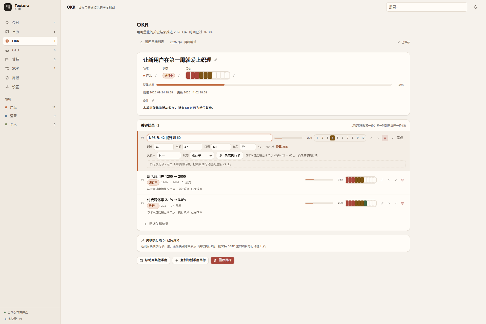

# Textura · 织理 — 使用手册

这份手册按「你想完成什么」组织，不按代码结构组织。所有操作都对应 0.1.0 的实际界面。

---

## 1. 五分钟上手

### 第一次打开会看到什么

应用启动后落在**今日**视图。侧栏顺序是「今日 → 日历 → OKR → GTD → 甘特 → SOP → 设置」。
空工作区会自动写入一份演示数据（共 30 条记录）：

- 3 个领域：产品、运营、个人；
- 1 个目标「让新用户在第一周就爱上织理」+ 3 个 KR（NPS、周活跃、付费转化，都带指标）；
- 1 个「新用户 onboarding SOP」，含开始 / 行动 / 判断 / 检查 / 结束共 7 个步骤与 7 条连线；
- 1 个「官网改版」项目 + 6 个带起止日期的行动，含 2 条依赖；
- 收件箱 6 条、下一步 3 条、等待 1 条、某天 1 条；
- 3 条 SOP 运行记录。

演示数据的所有日期都相对「今天」生成，所以任何时间打开都有当天到期与超期的条目。

### 清空演示数据

设置 → 维护 → **重置为演示数据**，会用内置演示数据整份替换当前工作区（会弹确认框）。
这个动作会先记录一次历史快照，`Ctrl/Cmd + Z` 可以回退整次重置。

想要一个**真正空白**的工作区，不要去逐条删除，直接导入一份空工作区即可：

```json
{"version":1,"items":[],"edges":[],"areas":[],"runs":[],"updatedAt":"2026-10-21T00:00:00.000Z"}
```

设置 → 导入 / 导出 → 导入 JSON… 选中这个文件并确认后，工作区会变成 0 条；
**重启后仍然是空的**——只有首次安装（主文件、`.bak`、轮换备份都不存在）且工作区为空时才会播种演示数据。
导入整份替换同样记录一次历史，`Ctrl/Cmd + Z` 能退回导入前的演示数据。

也可以「就地改造」，保留演示数据里的领域与结构：

1. 在 OKR 里删掉演示目标，建立自己的目标与 KR；
2. 在 SOP 里保留或删除演示流程，画出自己重复发生的工作；
3. 在 GTD 里把演示收件箱逐条「2 分钟处理」或删除；
4. 甘特里删掉「官网改版」，或直接改造成真实项目。

### 建立自己的工作区

推荐顺序：先定领域（演示的 3 个领域可直接沿用，当前版本界面不提供新增领域入口）→
写 1–3 个季度目标 → 把目标拆成项目 → 用快速收集把脑子里的事倒进收件箱 → 每天从「今日」开始推进。

---

## 2. 快速收集

快速收集是 GTD 收件箱的入口：**GTD 页头的「快速收集」按钮**（主按钮）是唯一的界面入口，
弹窗标题为「收集到 GTD 收件箱」。全局随时可用的是 `Ctrl/Cmd + N`（也支持 `Ctrl/Cmd + Shift + N`）
与命令面板里的「快速收集」命令。它的设计目标是**先记下来，别当场分类**。

### 语法

| 写法 | 作用 | 落到哪个字段 |
| --- | --- | --- |
| `#标签`（可多个，空格分隔） | 打标签 | `tags` |
| `@场景`（可多个，第一个生效） | 采上下文 | `gtd.context`（不带 `@`） |
| `!高能` / `!中能` / `!低能` | 标能量（也接受 `!high` / `!medium` / `!low`） | `gtd.energy` |
| `/今天` `/明天` `/后天` `/本周` `/下周` `/周一`…`/周日` | 设截止日期 | `gantt.end` |

语法片段会从标题里被剥离，输入框下方实时显示解析出的标签、场景、能量、到期日。
只有标签没有标题时（例如只输入 `#qa @电脑`），「收集」按钮为禁用状态。

例：

```
给财务回电确认发票抬头 #财务 @电话 !低能 /明天
```

标题存为「给财务回电确认发票抬头」，标签 `财务`，场景 `电话`，能量低，截止日期 = 明天。

### 连续收集与撤销

- `Enter`：收集并继续（输入框自动清空并保持焦点）；
- `Ctrl/Cmd + Enter`：收集并关闭；
- `Esc`：关闭；
- 每次收集都会在「本次会话已收集」里留下一条，点右侧垃圾桶图标可撤销**最后一条**
  （它同时会从收件箱删除）。

收集出来的条目类型是「行动」，状态是 `inbox`，`clarified = false`——它一定先进收件箱，
再走下一节的澄清流程。

---

## 3. GTD：收集 → 澄清 → 组织 → 回顾 → 执行

GTD 视图有两个标签页：**流程台**（日常主界面）和**周回顾**。

### 3.1 收集

所有入口：GTD 页头的「快速收集」按钮、全局快捷键 `Ctrl/Cmd + N`、命令面板里的「快速收集」命令。
它们都只做一件事：把内容放进 GTD 收件箱，不要求你现在决定它是什么。顶栏与今日页不再放收集按钮，
今日页的空态引导会直接把你带到 GTD 去收集。

### 3.2 澄清

收件箱里点标题（或选中后按 `Enter`）打开**澄清这一条**表单。每个字段的用途：

| 字段 | 用途与建议 |
| --- | --- |
| 类型 | 「下一步行动」= 一个能立刻做的具体动作；「项目（升级）」= 需要多步完成的事，提交后会**新建一个项目**并把这条归档；「参考资料 / 笔记」= 不需要行动，归档 |
| 能量 | 做这件事需要的精力。低能量场景（通勤、深夜）可以筛低能量任务 |
| 标题 | 用动词开头写清「做什么」：写「给张律师发隐私政策终稿」，不写「隐私政策」 |
| 备注 | 成功标准、链接、下一步线索；归档时这里会追加带时间戳的澄清记录 |
| 场景 context | 在什么状态下能做：电脑 / 电话 / 外出 / 会议 / 深度工作，或自定义（例如「通勤」） |
| 预计时长 | 只用于判断 2 分钟规则；选「2 分钟」会同时勾上「2 分钟规则」 |
| 截止日期 | 写入甘特的结束日期，决定它是否出现在今日「到期 / 超期」 |
| 领域 | 归属哪个领域，用于侧栏计数与筛选 |
| 标签 | 空格或逗号分隔，`#` 可省略 |
| 委派给他人，进入等待 | 状态变 `waiting`，必须填「等待对象」（例如「法务 · 张律师」） |
| 某天 / 搁置 | 状态变 `someday`，暂时不做但保留 |
| 属于 2 分钟规则 | 只是提示，不改状态；建议真的现在就做完 |

「委派等待」与「某天 / 搁置」互斥，勾一个会自动取消另一个；归档类型下这两个勾选会禁用。

提交后的状态映射：

- 下一步行动 → `next`；
- 项目（升级）/ 从笔记转为行动 → 新建条目 + 原条目 `done`（备注里记录新条目 id）；
- 参考资料 / 笔记 → 原条目 `done`（归档，不再出现在收件箱）。

### 3.3 组织

**下一步**面板把 `status = next` 的行动与项目按场景分组：

- 排序：有截止日期优先（早→晚）→ 无日期 → 同日期按能量高→低 → 创建时间早→晚；
- 筛选器：场景下拉（含「无场景」）、「仅今天/超期」开关、领域下拉；顶栏搜索框同时过滤标题、备注、场景、等待对象与标签；
- 组标题可点击折叠；**单击**行内标题即可就地改名（`Enter` 保存、`Esc` 取消）；`x` 勾完成，`Enter` 打开澄清。

**等待中**按已等待天数倒序，超过 7 天显示「超过 7 天」徽标；「催办」会在备注追加一条带时间戳的记录。

**某天 / 搁置**里的条目可一键「激活为下一步」。

**项目健康度**列出所有项目：完成动作数 / 总数、未完成数、完成度进度条，以及「停滞 / 健康」判定。
停滞项目会出现「新建下一步」按钮，直接补一个挂在该项目下的 `next` 行动。

### 3.4 回顾

切到「周回顾」标签页，统计窗口是**今天往前共 7 天**。卡片依次是：

| 卡片 | 读法 |
| --- | --- |
| 收件箱清零 | 当前待澄清条数 + 本周澄清进度（本周已澄清 / （待澄清 + 本周已澄清）） |
| 本周完成 | `completedAt` 落在窗口内的条目（与今日页「近 7 天完成」同一口径，按本地日历日计算） |
| 超期承诺 | 结束日期早于今天且未完成、未放弃 |
| 停滞项目 | 没有下一步行动、或所有未完成动作都不在 `next` 状态的项目 |
| 等待超 7 天 | 等待天数严格大于 7 的条目 |
| 无日期任务 | 状态为 next / active 但没有起止日期的行动与项目 |
| 长期无动作的领域 | 该领域下未收尾的行动 / 项目里，最近更新时间已超过 14 天 |

每张卡片右上角可以标记「已回顾」，顶部进度条显示回顾完成度；「全部标记已回顾」一键置满。
标记状态只存在当前会话，不写入工作区。

### 3.5 三个小场景

**两分钟规则**：收件箱里看到「给财务回电」，直接点「2 分钟处理」——它会被标记完成并给出提示，
永远不会留在系统里。判断依据是「打开就能做完」，不是「看起来简单」。

**委派与等待天数**：把「法务审核隐私政策」澄清为「委派给他人，进入等待」，等待对象填「法务 · 张律师」。
它进入「等待中」，从收集时间开始算天数；超过 7 天变红并提醒你催办。点「催办」会在备注写一条
「催办：已提醒 法务 · 张律师，等待回复。」，方便回溯沟通节奏。

**停滞项目修复**：周回顾里发现「官网改版」标了「停滞」——因为它有未完成的行动，但一个都不在 `next`。
去项目健康度点「新建下一步」，系统会创建一个「推进：官网改版」的子行动并设为 `next`，
项目立刻回到健康状态，之后你可以把它改名成真正要做的那一步。

### 3.6 键盘

在收件箱 / 下一步列表获得焦点时：`↑` `↓` 移动高亮行，`x` 完成当前行动，`Enter` 打开澄清。
`Ctrl/Cmd + Z` 在列表里撤销上一步写操作（在输入框内则交给浏览器原生撤销）。

---

## 4. OKR

### 4.1 季度

顶部季度条显示所有已有目标的周期，当前季度带「本季」标记，右侧数字是该季度目标数；
点季度切换，点「新建季度」可选择年份与季度并直接切过去。切季度只影响显示，不改数据。

目标卡右上角的「更多」菜单：

- **移动到其他季度**：把目标（含 KR）整体改周期；
- **复制为新季度目标**：复制目标与全部 KR，KR 的当前值会重置为起点，执行项关联不复制；
- **删除目标**：连同其下 KR 一起删除（可撤销）。

列表卡片是**只读**的：标题、信心、KR 都只显示，卡片里没有任何输入控件；
需要修改时点卡片头部的「编辑」进入目标编辑视图（见 4.8）。

### 4.2 目标与 KR 怎么写

- **O 是一句话的方向**，定性、不含数字：「让新用户在第一周就爱上织理」。
- **KR 是可验证的结果**，2–4 个即可：带起点与目标值，能回答「做到了没有」。
  写「NPS 从 42 提升到 60」，不写「优化 NPS」。
- 在目标编辑视图底部点「新增关键结果」（点开才出现输入框，回车创建，默认信心 5），随后点 KR 行铅笔补指标。

### 4.3 指标（起点 / 当前 / 目标 / 单位）

在目标编辑视图里，**先点某条 KR 行右侧的小铅笔**，该行才会展开指标编辑器（四个输入框）；
默认状态下 KR 行只显示只读的指标摘要（例如「42 → 60 分」）。表格视图展开 KR 行也保留就地编辑：

| 字段 | 含义 |
| --- | --- |
| 起点 | 季度开始时的值 |
| 当前 | 现在的最新值（每次更新只改这个） |
| 目标 | 季度结束要达到的值 |
| 单位 | 分 / 人 / % / 次…，仅展示 |

进度按 `(当前 − 起点) / (目标 − 起点)` 换算并夹在 0–100%。目标小于起点的**负向指标**
（例如「崩溃率从 3% 降到 1%」）同样适用，因为公式是线性的。起点等于目标时不换算：
达到目标记 100%，否则 0%。

指标是全季度唯一的进度来源，所以「当前值」要定期更新——它比勾完成更能反映真实进展。

输入行为：改数字时界面立即更新，但**写回与保存会在停止输入 600ms 后合并成一次**；失焦、按 `Enter`
会立刻提交。切换视图、切到别的季度或关闭窗口前，未提交的输入会先被 flush 再保存，不会因为「没点空白处」
而丢掉最后一次修改。

### 4.4 信心指数

目标的信心刻度在编辑视图里**默认只读**：点信心右侧的铅笔后刻度才可点选，点一个数字即打分并收起编辑态；
KR 的信心随该行编辑态一起可改（点 KR 行铅笔后直接点刻度）。列表卡片显示只读刻度：

- 1–3 低、4–6 中、7–10 高；OKR 页顶部按这三档统计分布。
- 用法建议：信心下降往往比进度落后更早预警。连续两周下调信心，就该缩减 KR 或改打法了。
- 信心只是主观判断，不参与任何自动计算。

### 4.5 「落后」怎么判定

```
落后 = (季度已过百分比 − KR 进度) ≥ 10
```

季度已过百分比按季度第一天 0% 到季度最后一天 100% 线性计算；KR 进度取指标换算或子项完成比。
也就是说，时间过半而 KR 只走了不到四成，才算落后。顶部「落后 KR」数量变色即为提醒。

### 4.6 把项目 / 行动关联到 KR

两条路径，都会显示在这条 KR 的执行项列表里：

1. 在目标编辑视图里点某条 KR 行的铅笔进入编辑态，再点「关联执行项」，在弹窗里搜索并勾选甘特 / GTD 里的项目与行动，确认后写入 `okr` 边；
2. 直接把项目 / 行动作为 KR 的子项（层级关系）。

同一个执行项同时命中两条路径时以边关联为准（可以解除）。执行项行内可勾完成、跳到对应视图，
「解除关联」只删边，不删条目。

### 4.7 三种视图

视图切换控件在**页头右侧**，从左到右依次是：密度（紧凑 / 详细，仅卡片视图出现）→ 卡片 / 表格 / 对齐 → 新建目标。
季度条只剩下季度 chips 与「新建季度」，不再放视图切换。

- **卡片**（默认）：适合日常浏览与进入编辑，可切「紧凑 / 详细」密度；
- **表格**：季度复盘用，一屏看完 O / KR / 指标 / 进度 / 信心 / 执行项数，KR 行可展开并就地编辑指标；
- **对齐**：目标 → KR → 执行项的大纲，用来检查「每个 KR 是否真的有抓手」。

顶栏搜索框在 OKR 页会过滤目标与 KR（匹配标题、备注、负责人、领域、标签）。

### 4.8 编辑单个目标

入口：每张目标卡头部工具区、**「更多操作」左侧的「铅笔 + 编辑」按钮**（无障碍名称为「编辑目标：<标题>」）。

进入后仍然是 OKR 页（`h1` 不变、URL 不变），但季度条、季度健康度、搜索筛选提示与卡片 / 表格 / 对齐列表
会隐藏，换成独立编辑视图。

编辑视图**默认是纯展示**的：标题、领域、状态、信心、备注、每条 KR 与「新增关键结果」都不挂载输入控件，
每处旁边有一支小铅笔（新增 KR 是一个按钮）。点铅笔才就地展开输入，**任何时刻只有一个编辑目标**：
点另一处会先自动结束上一处（失焦即提交），所以不会出现「两个字段同时半编辑」的状态。

- **顶部**：「返回目标列表」、面包屑「2026 Q4 · 目标编辑」、保存状态（已保存 / 保存中… / 保存失败）；
- **Hero**：标题、领域、状态、信心 1–10、整体进度、创建与更新时间、备注——每项一支铅笔，点开才可改；
- **关键结果 · N**：每行默认只读（标题、状态、指标摘要、负责人、信心、进度、执行项摘要），
  行尾提供铅笔 / 上下移 / 删除。点铅笔展开该行的完整编辑器：标题、指标（起点 / 当前 / 目标 / 单位）、
  负责人、状态、关联执行项、执行项勾选，以及收起用的「完成」按钮。
  **同级 KR 互斥**：同一目标下同时最多一行处于编辑态，点另一行的铅笔会自动提交并收起上一行；
- **新增关键结果**：底部是一个按钮，点开才出现输入框（回车创建，默认信心 5），不是常驻输入框；
- **执行项概览**：关联执行项 N · 已完成 M（同一条执行项经不同路径出现只计一次）；
- **目标操作**：移动到其他季度 / 复制为新季度目标 / 删除目标。



保存时机：标题在失焦或回车时提交；领域、状态、信心在选完即保存；备注在停止输入 **600ms** 后提交，
失焦、点「返回目标列表」、切换编辑目标或离开页面时会立即 flush。KR 指标沿用既有的 600ms 提交与 `pagehide` flush。

返回与取消：`Esc` 是**两段语义**——焦点在字段里时，第一下 `Esc` 取消当前字段（回退到上次提交值）
并收起该处编辑态，视图不退出；再按一次 `Esc` 才返回目标列表（弹窗内不触发，避免误关弹窗）。
字段内 `Enter` 等于提交（标题、负责人）；KR 行里的「完成」按钮等价于收起该行。
收起编辑态后焦点回到该字段的铅笔上，返回列表后焦点回到刚才那张卡片的编辑按钮。

目标操作的行为：

- **移动到其他季度**：目标与它的全部 KR 一起换季度；仍停留在编辑视图，面包屑随之更新；
- **复制为新季度目标**：新建一份目标（KR 当前值重置为起点、执行项关联不复制），仍停留在当前目标的编辑视图；
- **删除目标**：确认后删除目标及其 KR，并自动回到列表（可用 `Ctrl/Cmd + Z` 撤销）。

限制：编辑视图是页面局部状态，**刷新页面会回到列表**（没有独立的 URL 深链）；卡片列表只读，
表格视图仍保留指标就地编辑（展开 KR 行后是 4 个指标输入）；1024×720 下 KR 行的操作按钮会换行；
同一目标下同时只有一个编辑目标（目标级字段之间、同级 KR 之间都互斥），想改另一处请直接点它的铅笔；
在编辑视图里打开「关联执行项」时，如果顶栏全局搜索框有内容，弹窗会用它作为初始查询（既有行为），
清空顶栏搜索即可从空查询开始。

---

## 5. 甘特

### 5.1 三种缩放

工具栏「日 / 周 / 月」分别对应 40 / 28 / 12 像素每天。切换缩放会把原来视口左边缘的日期留在左边缘，
不会跳回起点。右侧显示当前可见区间（例如「10月 20 – 11月 16」）与「已排期 / 可排期」计数。

导航：「上一段 / 下一段」按 80% 视口宽度滚动，滚到尽头时自动向左 / 右扩展时间轴；
「今天」把今天滚到视口 35% 处；「适配窗口」回到最早任务前 4 天。

### 5.2 拖拽改期与吸附

- 拖**条形本体**：整体平移，开始与结束同时移动；
- 拖**左边缘 / 右边缘**：只改一端，最小 1 天，两端不会被拖反；
- 吸附粒度是 **1 天**（三种缩放都是），`Esc` 取消本次拖拽；
- 松手才写回：一次拖拽只产生一次撤销记录、一次保存。

需要注意：拖动到视口边缘**不会自动滚屏**。拖远距离时先滚动时间轴再拖，或临时切到「月」缩放。

另一个行为：子任务拖出父级项目的日期区间时，保存照常，但会给一条提示「已超出父级…的区间，仍按拖拽结果保存」。
系统不会自动裁剪。

### 5.3 依赖

依赖在**详情面板**里建（工具栏「详情」打开右栏）：

1. 选中任务；
2. 在「依赖」区选择方向：「当前任务依赖…」（当前任务是依赖方）或「…依赖当前任务」（当前任务是前置）；
3. 选目标条目 → 「添加依赖」。

依赖在时间轴上画成折线箭头（前置结束 → 依赖方开始），当中间行有任务条挡住竖直通道时自动绕行；
与选中条目相关的依赖会高亮。列表里每条依赖都可删除。

依赖只表达关系，**不会**重排日期，也**不检测环**（A→B→A 可以建出来）。

### 5.4 分组与折叠

左侧行模型以顶层项目 / SOP 为分组：分组头显示标题、条目数、区间汇总与完成度（子项完成比）。
分组按「有日期优先」排序，组内按开始日期升序、无日期在后。不属于任何分组的可排期条目
（例如直接挂在 OKR 下的行动）会进「未分组」组。点分组头左侧的箭头可以折叠 / 展开。

双击左侧标题可就地改名；无日期的条目在行尾有「排期」按钮，一键设成「今天起 3 天」。

### 5.5 进度的含义

甘特条的填充宽度来自两个来源：

- `status = done` 的条目**一律显示 100%**，详情面板里进度滑杆会禁用并注明「已完成条目进度按 100% 显示」；
- 其余条目显示手工维护的 `gantt.progress`（0–100，步长 5）。

完成状态不会把 100 写进 `gantt.progress`。所以取消完成时，它会回到你原来填的数值——
这是有意的：`status` 决定「完成没有」，`progress` 记录「做了多少」。

### 5.6 哪些条目会出现在甘特

只有 `project` / `action` / `milestone`，且状态不是 `inbox`、`someday`、`dropped`。
收件箱与「某天」里的东西不会自动排期——这是刻意的，先澄清再排期。

---

## 6. SOP

### 6.1 从零画一条流程

1. 左栏「流程」+ 新建，输入名称（可归入某个领域），回车创建；
2. 空画布上点「添加开始节点」，得到一个 `start` 节点；
3. 工具栏的「行动 / 判断 / 检查 / 结束」按钮会在视口中心新建节点；**若当前选中了某个节点，
   新节点会自动与它连一条线**，这是最快的串联方式；
4. 也可以手动连线：从节点边缘的圆点拖到另一个节点；
5. 选中节点后在右栏检查器里改标题、说明、类型、负责人、预计时长；
6. 点「运行」走一遍，检查分支是否走得通。

### 6.2 节点类型怎么选

| 类型 | 什么时候用 |
| --- | --- |
| `start` 开始 | 流程唯一入口；运行模式优先从这里开始（没有 start 时取入度为 0 的节点） |
| `action` 行动 | 有人要动手做的一步，最常用 |
| `decision` 判断 | 需要分叉的地方，配 2 条以上出边并加标签 |
| `check` 检查 | 有明确检查项的一步；新建时会自动带一条「检查项」，可在检查器里增删勾选 |
| `end` 结束 | 流程出口；没有出边的节点也会被当作结束 |
| `note` 便签 | 只做说明，不参与执行语义 |

### 6.3 自动布局

工具栏「自动布局」用 dagre 分层排布（自上而下，同层间距 60px，层间距 90px，左上留白 40px），
布局后自动「适应画布」。适合节点超过 6 个、手摆已经乱掉的时候。运行模式下自动布局禁用。

撤销粒度：一次完整拖拽（无论拖了几个节点）、一次自动布局，都只算**一步**；
`Ctrl/Cmd + Z` 会整体回到操作前的坐标，而不是逐个节点退。

### 6.4 连线与分支标签

选中一条连线，在检查器里改标签。常用标签有一键预设：**是 / 否 / 通过 / 补充 / 继续**，
也可以自己写。标签会显示在连线上，运行到多出边节点时就是分支按钮上的文字。

### 6.5 检查项

选中 `check` 节点，检查器里可以添加 / 删除 / 勾选检查项。节点卡片底部会显示「已完成/总数」计数
与一条细进度条，但检查项勾选**不会**影响运行结果——运行结果仍然是你在运行条上点的通过 / 未通过 / 跳过。

### 6.6 运行模式

点工具栏「运行」：

- 起点：优先 `start` 节点，否则入度为 0 的第一个节点；
- 当前步骤高亮，其它走过的节点标为已访问、未通过的标红；视口会自动把当前步骤带进可见范围；
- 运行条上有三个按钮：**通过 / 未通过 / 跳过**。三者都会让流程继续——区别在于记录了什么；
- 当前步骤有多条出边时，会弹出分支选择（未走过的分支排在前面）；只有一条出边时直接前进；
- 没有出边时流程结束，提示「通过 x / 未通过 y / 跳过 z，耗时 n 分钟」；
- 每一步的结果都会立刻写入运行历史（`runs`）；`Esc` 退出运行。

运行是「照着图走一遍」的记录工具，不会阻止你跳步，也不会自动回滚数据。

### 6.7 布局建议

- **纵向（默认，自动布局）**：步骤多、有分支、需要在窗口里上下滚动看的时候。7 步以上的流程
  基本都该用纵向。
- **横向手摆**：流程图是「一条直线 + 少量旁支」且你希望一屏横向看完时（演示数据就是这种手工 240×160 网格）。
- 打开一张横向很宽的旧流程时，画布会先显示一份**紧凑的纵向预览**（只影响显示，不写数据）。
  一旦你拖动节点、点自动布局或撤销，就会回到已保存的坐标——第一次拖动会把这份预览坐标
  一次性写回，因此它也只占**一步撤销**，一次 `Ctrl/Cmd + Z` 就回到打开时的状态。
- 节点标题控制在 12 个汉字内，超出的部分在卡片里换行会挤压检查项显示。

---

## 7. 今日

### 7.1 今日聚焦怎么排

数据来自三处，按顺序合并并按 id 去重：

1. **超期**：结束日期早于今天且未完成 / 未放弃——组内按结束日期升序（拖最久的在最上）；
2. **今天到期**：结束日期等于今天；
3. **无日期**：`status = next` 的行动与项目（不含 SOP 步骤）。

组与组之间永远是这个顺序，所以「今天必须先处理超期」。标题下方给出
「x 超期 · y 今天 · z 无日期」与一句话摘要。

### 7.2 四张卡

| 卡片 | 含义 |
| --- | --- |
| 收件箱待澄清 | `status = inbox` 的条数，点开去 GTD 澄清 |
| 近 7 天完成 | `completedAt` 在最近 7 个本地日历日内的条数（不是自然周；与 GTD 周回顾的「本周完成」同一口径） |
| 活跃 OKR 平均进度 | 当前季度目标的进度平均值 |
| 最近 SOP 运行 | 最近一条运行记录的结果（通过 / 失败 / 跳过）与相对时间 |

点卡片会跳到对应视图；点聚焦行的标题会跳到该条目所属的视图并选中它
（行动 / 项目 / 里程碑 → 甘特，目标 / KR → OKR，笔记 / 资料 → GTD，SOP 步骤 → SOP）。

右侧还有「OKR 概览」（逐目标进度条）、「SOP 快速启动」（最多 4 个流程 + 最近运行结果）
和「最近活动」（SOP 运行 + 完成记录，各取最近 5 条按时间倒序）。

---

## 8. 日历

日历把「哪一天要做什么」和公历 / 农历放在同一张表上。侧栏位于今日之后，深链是
`?route=calendar`（也可以 `?route=calendar&item=<id>` 直接选中某条）。

### 8.1 月视图与周视图

工具栏左侧的「月 / 周」切换：

- **月视图**：固定 6×7 网格、周一起始（含上月末与下月初的补位格）。每格显示公历日与一条农历标签；
  今天有圆环、选中日有描边；格底最多 3 个领域色圆点代表当天日程，超出的显示 `+N`。
- **周视图**：周一到周日 7 列，每列列出当天条目。跨天条目显示「第 n/m 天」，只有截止日期的条目显示「截止」；
  点星期标题切换选中日，点卡片直接打开条目。

日历只显示**带日期**的条目（`gantt.start` 或 `gantt.end`）：已放弃的条目不出现，
没有日期的收件箱内容也不会凭空出现——先澄清、再加日期。

### 8.2 导航与年月跳转

- 「上一段 / 下一段」：月视图按月翻，周视图按周翻；「今天」回到今天并选中。
- 年份下拉（1900–2100）与月份下拉可以直接跳；改年月时尽量保留当前「日」，
  遇到短月会自动夹到月末（例如 1 月 31 日切到 2 月会落在 28 / 29 日）。
- 月视图键盘：`←` `→` 前后一天，`↑` `↓` 前后一周，`Home` / `End` 到本周首 / 末，
  `PageUp` / `PageDown` 上一月 / 下一月，`Enter` 进入当日面板。

### 8.3 农历、节气与节日

每格的农历标签按优先级取一个：**传统节日 > 节气 > 农历日**（农历初一显示月名，例如「九月」）。

- 传统节日：春节、元宵、龙抬头、端午、七夕、中元、中秋、重阳、腊八、小年、除夕
  （除夕按农历腊月最后一天判定，可能是廿九或三十）。
- 24 节气按太阳视黄经计算；清明既是节气，也按节日标签显示。
- 干支与生肖按**农历年**（春节换年），不是公历 1 月 1 日。
- 支持范围 **1900-01-31 ～ 2100-12-31**。超出范围时格子只显示公历，当日面板提示「农历数据超出支持范围」。
- 页头副标题会显示当前区间、干支生肖与农历月，例如「2026年10月 · 丙午马年 · 农历九月」。

### 8.4 当日日程面板

选中某天后，右侧面板显示：

- 公历全称 + 星期、农历全称（如「丙午年 九月初一」）、相对今天的文案（今天 / 明天 / n 天后）、
  节日与节气 Badge、当天条目数；
- 条目行：类型图标、标题、领域、状态徽章；跨天条目附「第 n 天 · 起始 – 结束」或「截止当天」。
  点标题打开条目所属视图（行动 / 项目 / 里程碑 → 甘特，SOP 步骤 → SOP，目标 / KR → OKR，笔记 → GTD）；
  右侧复选框可直接勾完成；
- **快速添加**：在底部输入标题按 `Enter`，会在这一天创建一条「行动」（状态 `next`，起止都是当天），
  因此它同时会出现在甘特里；
- **在甘特中查看**：优先打开当前选中的条目，否则打开当天第一条，并跳到甘特；
- 右上角关闭按钮与工具栏的「收起日程 / 展开日程」都可以折叠面板。

### 8.5 窄屏（≤1180px）的面板行为

窗口宽度不超过 1180px 时，当日面板变成**底部覆盖式抽屉**，会盖住网格下半部分（不是挤压布局）：

- 点任意日期会自动展开抽屉，方便直接看当天安排；
- 一旦你手动收起，本次会话里不会再自动弹出，直到点「展开日程」；
- 抽屉展开时选中其它日期，内容会就地切换，不需要反复开关。

### 8.6 视图状态

月 / 周的选择与当前选中日期只保留在**本次会话**：切到别的视图再回来还在原处，
刷新页面或重启应用后回到月视图 + 今天。

---

## 9. 周报 / 月报 / 季报

这一章回答四个问题：期次怎么选、草稿怎么来、正文怎么写、什么时候该定稿。
读完你能独立产出一份有数据、能预览、导出得出去的周报。

入口在侧栏「周报」，深链是 `?route=reports`（命令面板搜「周报」也能到）。

### 9.1 三种粒度与期次

页头左侧的「周报 / 月报 / 季报」切换粒度，右侧是期次翻页。期次键是这三类之一：

| 粒度 | 期次键 | 期次文案示例 | 覆盖范围 |
| --- | --- | --- | --- |
| 周报 | `2026-W44` | 2026 年第 44 周 | 周一到周日（ISO 8601，周一起始），含首尾 |
| 月报 | `2026-11` | 2026 年 11 月 | 该自然月，含首尾 |
| 季报 | `2026-Q4` | 2026 年第四季度 | 该自然季度，含首尾 |

- 切换粒度会落到**当前**对应的期次（11 月切到月报就是 `2026-11`），不会沿用上一粒度的键。
- 「上一期 / 下一期」按粒度翻页，跨年由日期运算处理：`2026-W01` 的上一期是 `2025-W52`；
  2026 年是 53 周年份，所以 `2027-W01` 的上一期是 `2026-W53`。不存在的周号（例如 `2025-W53`）不会被造出来。
- 具体起止日在右栏「数据源」的面板头上显示为 `11/02 – 11/08`；导出正文里另有完整日期。
- 期次只决定「统计哪一段时间的条目」，不改任何条目本身。

### 9.2 三栏界面

| 栏位 | 内容 |
| --- | --- |
| 左栏（220px） | 当前粒度的期次列表：搜索框（按「期次 / 标题 / 正文」搜）+ 每行「期次文案 / 状态徽标 / 标题（改过才有）/ 字数」 |
| 中栏（自适应） | 编辑区：标题、报告人、导出按钮、状态与字数，以及各节正文 |
| 右栏（280px） | 「数据源」与「AI 参考」两个标签（默认数据源），数据源列出本期可一键插入的素材 |

窗口宽度不超过 **1180px** 时变单列堆叠（1024×720 就在这个区间）：期次列表、数据源列表都不再内部滚动，
而是跟着页面一起滚。左栏顶部常驻当前粒度的份数；列表为空时显示「还没有报告」，并提示先选好期次再生成草稿。

### 9.3 生成草稿

当前期次还没有报告时，中栏是空态，页头右上与空态里各有一枚「生成本期草稿」。点它按模板一次生成全部章节：

| 粒度 | 节数 | 节序 |
| --- | --- | --- |
| 周报 | 6 | 本周概览 / 本周进展 / 量化指标 / 风险与阻塞 / 下周计划 / 需要的支持 |
| 月报 | 6 | 本月概览 / 本月进展 / 量化指标 / 风险与阻塞 / 下月计划 / 需要的支持 |
| 季报 | 7 | 本季概览 / 本季进展 / 目标与关键结果 / 量化指标 / 风险与阻塞 / 下季计划 / 需要的支持 |

生成的正文是**能直接读的纯文本**：每节以 `### 小节标题` 开头，条目是 `- ` 列表，风险按四类分组（`####` 小标题），
进展按领域分组、每领域最多 8 条，超出补一行「另有 N 条…」。

每节头部有一个来源徽标，说明这节正文是怎么来的：**自动汇总**（模板生成）/ **已手改**（你动过）/
**AI 生成**（采用了 AI 参考）。

口径上要注意两点：

- **未来期次不冒充结论。** 概览里的风险行写「风险：本周期尚未开始」而不是「风险：0 项」；风险节只有一行
  「本周期尚未开始，暂无风险数据」，不会列出四类「无」；量化指标写「本周期无关键结果数据 / 本周期无 SOP 运行记录」；
  季报的目标节只列目标名 +「本季度尚未开始」，不给完成度百分比。
- **空工作区也能生成。** 进展写「本周期无完成记录」，计划写「下周期尚未排期」，支持节是固定占位
  「（待补充：需要哪些支持、决策或资源）」。空工作区生成的报告是一份合法报告，不是错误状态。

### 9.4 编辑与落盘

标题、报告人、各节正文都是「输入即存」，但**不是每个按键都写盘**：

| 动作 | 落盘时机 |
| --- | --- |
| 改标题 / 报告人 / 正文 | 停止输入 600ms 后合并成一次写入 |
| 插入素材、清空、重新汇总、添加 / 改名 / 上移 / 下移 / 删除章节、采用 AI 参考 | 立即写入（连同防抖窗口里还没写盘的标题与报告人一起） |
| 切期次、切报告、定稿、离开这一页 | 先把未落盘的编辑写回，再执行 |

其它细节：正文框按内容自适应 6–22 行（超过 22 行内部滚动）；字数按整份草稿统计；值逐字没变时不写盘
（浏览器原生撤销触发的那次 `onChange` 会被跳过），所以不会白刷新更新时间、也不会多一条撤销记录。
撤销 / 重做是整份工作区快照，上限 80 步，与「数据管理」一章所说的一致。

### 9.5 自定义章节

章节顺序就是**存储顺序**，也就是屏幕顺序与导出顺序，模板节同样可以移动。

- **添加**：列表末尾「添加章节」在最后追加一节，标题默认「自定义章节 N」，输入框自动聚焦，可以直接改。
- **改名**：回车或失焦保存，`Esc` 放弃本次输入；标题清空后失焦会还原成原名，不会留下无名章节。
  输入框最多接 120 字，写入时连续空白会被压成一个空格。
- **上移 / 下移**：一次移动一格，首节的「上移」与末节的「下移」置灰。
- **删除**：只有自建章节有删除按钮，删掉后可 `Ctrl/⌘ + Z` 撤销。
- **模板节的标题不可改、也没有删除按钮**：模板标题是「重新汇总」和 AI 章节清单的口径，改名会被下次重算覆盖回去；
  删掉的模板节也会在下次打开时被补回来。
- **历史遗留 key**（既不是模板节也不是 `custom-*` 的节）照常显示、可编辑、可移动、可清空，但**没有「重新汇总」**——
  那个按钮只按模板重算，对这类节点点了只会得到「未知章节」。

上限是**每份报告 40 节**（存储上限）：已经存满 40 节后「添加章节」置灰（按钮的 `title` 写明上限与原因），
界面不会放你再加一节然后下次加载被裁掉。只数真正落盘的节，旧报告里补出来的模板空节不占额度。

旧报告缺节时，编辑器会按模板的相对位置把缺的节补在屏幕上（例如季报缺「目标与关键结果」，它会出现在「本季进展」
与「量化指标」之间）。这类空节还没写进报告，因此不参与移动；你一旦在里面打字、插入素材、清空、重新汇总或采用
AI 参考，它会先按**当前屏幕位置**落成一节再写入，不会跳到列表末尾，也不会把你的焦点弄丢。

已知边界：当两个已落盘的节之间夹着一个补出来的空节时，下移看起来像跨过了两行——它只与下一个**已落盘**的节交换位置。

### 9.6 Markdown 编辑与预览

每节工具条最左边是「编辑 / 预览」，默认编辑。

- 预览只替换正文框：节头、徽标、操作按钮、字数、防抖与导出全都不变，**预览不改内容**。
- 预览是纯展示，导出（「复制 Markdown」/「下载 .md」）永远是原始 Markdown 文本，不是排版结果。
- 导出用的是**当前缓冲**，刚敲的字不用等 600ms 也能导出；空正文的节整节跳过，不留孤立标题；
  正文里没自带标题的节，导出时会补一行 `### 节标题`，标题在这里被压成一行（不裁剪、不加省略号）。
- 草稿的每节各自记「编辑还是预览」，切换报告不会把 A 报告的选择带到 B 报告上；新增的节默认编辑。
- **定稿后强制预览**，不给切换：内容已冻结，这时「读」比「改」更重要。空节切到预览显示「本节暂无内容」。

### 9.7 预览支持的语法

预览对齐的是 **Obsidian 阅读视图**：正文里写什么，预览就按 Obsidian 的样子显示什么。下面按语法族列出
「怎么写 / 预览里长什么样」，可以直接照着自查。

**基础格式**

| 语法 | 示例 | 预览里长什么样 |
| --- | --- | --- |
| 标题 1–6 级 | `# 一级` 到 `###### 六级` | 按原级别**样式**渲染（`.reports-md-h1`…`.reports-md-h6`：字号 13.5px 递减到 12px、字重 650 递减到 600，节标题自己是 13.5px / 620；`#####` / `######` 用弱化色），但**标签降三级**输出（`#`→`<h4>`、`##`→`<h5>`、`###` 及更深一律 `<h6>`，`h6` 封顶），这样正文标题永远在页面标题 `<h1>` 与节标题 `<h3>` 之下；代价是 h4–h6 在语义大纲里合并成 `h6`，视觉级别仍由 `.reports-md-h1…h6` 区分 |
| 段落与换行 | 两行文字直接连着写 | 同一个段落，**行与行之间保留换行**（软换行也显示为换行） |
| 硬换行 | 行尾两个空格，或行尾一个 `\` | 换行；与软换行看起来一样 |
| 分割线 | 单独一行 `---` | 一条横线（正文最开头的 `---` 另有含义，见下面的 frontmatter） |

**行内强调与代码**

| 语法 | 示例 | 预览里长什么样 |
| --- | --- | --- |
| 粗体 | `**重要**` | 加粗 |
| 斜体 | `*强调*` | 倾斜 |
| 粗斜体 | `***都要***` | 又粗又斜 |
| 删除线 | `~~作废~~` | 删除线 + 弱化色 |
| 高亮 | `==关键==` | 强调色底纹，文字色不变；`a == b == c` 这种比较写法不会被误判 |
| 行内代码 | `` `config.json` `` | 等宽 + 浅底 |
| 转义 | `\*这不是斜体\*` | 原样显示星号 |

**链接与图片**

| 语法 | 示例 | 预览里长什么样 |
| --- | --- | --- |
| 链接 | `[周报说明](https://example.com/doc)` | 「周报说明」+ 灰色小字「（https://example.com/doc）」；**不可点击**，地址可选中复制 |
| 裸链 | `https://example.com` | 同上，自动识别成链接 |
| 被拦下的链接 | `[部署](./deploy.md)`、`[点我](javascript:alert(1))` | 只留文字加虚线下划线，悬停说明「链接已拦截」；不产生任何可点元素 |
| 图片 | `` | 灰字占位「图片：架构图（https://example.com/a.png）」，不加载图片 |

**列表、任务与表格**

| 语法 | 示例 | 预览里长什么样 |
| --- | --- | --- |
| 无序列表 | `- 甲` | 带项目符号的列表 |
| 有序列表 | `1. 甲` | 带编号的列表，**保留你写的起始编号**（从 `3.` 开始就是 3、4、5） |
| 嵌套列表 | 子项缩进两个空格 | 子列表挂在父项下面，缩进层级与源码一致 |
| 任务列表 | `- [ ] 待办` / `- [x] 做完` | 每项前面一个**只读复选框**（不能勾），读屏播报「未完成 / 已完成」 |
| 表格 | 竖线分隔 + `:---` / `:---:` / `---:` 分隔行 | 真表格；对齐按分隔行生效（左 / 中 / 右），列多时整表可横向滚动 |

**代码、公式与图**

| 语法 | 示例 | 预览里长什么样 |
| --- | --- | --- |
| 围栏代码块 | 三个反引号 + 语言名 | 等宽代码块，可按 Tab 聚焦（聚焦后可横向滚）；有语言名时读屏念「代码块（python）」 |
| 语法高亮 | 语言名写 `python` / `js` 等 | 内置高亮覆盖 html、css、js、ts、jsx、tsx、python、bash、json、yaml、sql、markdown；其它语言照纯文本显示，代码一字不少 |
| 行内公式 | `$E = mc^2$` | 排版后的公式；KaTeX 还没加载好时先显示原始 TeX |
| 块级公式 | 单独一行 `$$`，公式，再一行 `$$` | 居中大号公式，超宽时在该行内部横向滚；写在**引用、callout、列表**里同样按块级公式渲染，TeX 里不会混进 `>` 或缩进 |
| Mermaid | 围栏语言写 `mermaid` | 画成图（`securityLevel: strict`）；定义写错时保留源码 + 一行「Mermaid 渲染失败」 |

**引用、callout 与 Obsidian 专有语法**

| 语法 | 示例 | 预览里长什么样 |
| --- | --- | --- |
| 引用 | `> 一行引用` | 左侧竖线的引用块；里面可以放列表、代码、表格 |
| callout | `> [!note]` 后跟正文 | 带类型色边框与类型符号的块。13 类：note / abstract / info / todo / tip / success / question / warning / failure / danger / bug / example / quote |
| callout 折叠 | `> [!note]-` 默认收起，`> [!note]+` 默认展开 | 头部变成可折叠的头（键盘也能开关，读屏会报展开状态） |
| callout 标题 | `> [!warning] 上线风险` | 标题用你写的「上线风险」，旁边补一个「警告」类型标签 |
| callout 嵌套 | 在 callout 里再写一层 `> > [!tip]` | 里外两层各自配色，逐层缩进 |
| callout 别名 | `[!summary]` `[!hint]` `[!caution]` `[!check]` … | 归一到规范类型（`summary`→摘要、`hint`→提示、`caution`→警告、`check`→成功 …），并沿用该类型的配色与默认标题 |
| 注释 | `%%这段话不显示%%` | 完全不出现。行内与跨行都算注释；围栏代码块与行内代码里的 `%%` 是字面量，不剥 |
| wikilink | `[[项目复盘]]`、`[[项目复盘\|复盘]]`、`[[项目复盘#结论]]` | 虚线圆角 chip，原样显示目标 / 别名 / 锚点；点了不跳转 |
| 数字别名 | `[[Page\|300]]` | 竖线后面一律当**别名**（chip 显示 `[[Page\|300]]`）；只有嵌入才把数字当尺寸 |
| 嵌入 | `![[架构.png]]`、`![[a.png\|640x480]]`、`![[架构.png#本周]]`、`![[架构.png#^结论]]` | 「嵌入：架构.png」「嵌入：a.png（640×480）」「嵌入：架构.png#本周」「嵌入：架构.png#^结论」——锚点（含 `#^` 块引用）原样显示；**不会真的展开内容** |
| 标签 | `#复盘`、`#季度/复盘`、中文标签 | 圆角 chip。`a#b`、`####没有空格`、`#2024` 不算标签，按文字显示 |
| 属性（frontmatter） | 正文第一行 `---`，接着若干 `键: 值`，再用 `---` 收尾 | 折叠成一行「属性 N」（N 是字段数），点开是「键 — 值」两列表；一个字段都读不出时（例如 `---` 紧接 `---`）整块不显示 |

自查方式：把上面任意几行示例整段粘进某一节并切到预览，逐行对照「预览里长什么样」这一列；再切回编辑，
确认原文逐字未变。

### 9.8 与 Obsidian 的差异

预览是「按 Obsidian 的样子显示」，不是「把 Obsidian 搬进来」。下面这些差异都是刻意的产品决定：

| 场景 | 这里的行为 |
| --- | --- |
| 正文标题的语义标签 | 保留作者写的层级做**视觉**分级（`.reports-md-h1…h6`），但标签**降三级**：`#`→`<h4>`、`##`→`<h5>`、`###` 及更深一律 `<h6>`。这样正文标题不会跑到页面标题（`<h1>`）与节标题（`<h3>`）之上，但 h4–h6 在读屏大纲里会合并成同一级。Obsidian 直接输出 `h1`–`h6` |
| 没有库（vault） | `[[wikilink]]` 与 `![[嵌入]]` 只是视觉化 chip：不解析文件、不补全路径、不检查目标是否存在、不发网络请求，点了也不跳转；嵌入不会真的展开成内容 |
| 属性（frontmatter） | 折叠成「属性」表，且只认**简化 YAML**：`键: 值`、`键: [a, b]`、`- 条目`（多值用「, 」连接）。不认嵌套映射、多行 `\|` / `>`、锚点、行尾注释；值一律当字符串；重复键取最后一次的值。只有正文最开头的 `---` 块算 frontmatter，未闭合的 `---` 按普通正文处理；**一个字段都读不出时不显示「属性」**（`---` 紧接 `---` 不会有空面板） |
| 原始 HTML | 一律转义成文字显示（`<div>`、`<script>` 原样可见，既不当结构也不执行） |
| 远程图片 | 不加载，只显示「图片：alt（src）」占位——桌面端 CSP 的 `img-src` 只允许本地资源，渲染真 `` 只会留一个碎图标 |
| 链接 | 一律不可点击：安全链接显示标签 + 灰色「（地址）」，其它协议、相对路径、页内锚点连地址都不显示，只留文字加悬停说明（桌面 webview 没有「用系统浏览器打开外链」的能力，真 `<a href>` 会把界面导航走且回不来） |
| callout 标题 | 按纯文本显示：标题里再写 `**粗体**`、`[[链接]]`、`==高亮==` 不会二次解析，原样显示字符 |
| 软换行 | 显示为换行（与 Obsidian 阅读视图的默认行为一致）。正文是「一行一件事」的写法，折成一段反而难读 |
| 插件语法 | Dataview、Templater、Canvas 等不支持，按普通文字显示 |
| 表格里的竖线 | 表行按 **GFM** 切分：**行内代码里的竖线同样算列分隔符**。单元格里要保留竖线，得在竖线前加一个反斜杠；不转义就会被切成两格，超出表头列数的格子还会被直接丢掉。Obsidian 不切，这里跟随 GFM |
| Mermaid 主题 | 图按**当前界面主题**定色，并且会跟着主题一起变：切浅色 / 深色时重新初始化并重绘当前预览里的图（订阅 `<html data-theme>`，**不需要刷新页面**）；重画期间旧图留在原地，不会闪成空白 |
| 按需加载 | KaTeX（数学）、Mermaid（图）、Prism（高亮）都是首次出现才下载，可能先看到原始 TeX / 源码 / 纯文本，随后替换成排版结果；三者都随应用打包，离线可用。数学只需**一次**请求：KaTeX 与 Mermaid 自带的 katex 副本被合并成一个 chunk（约 525 kB，两份版本不同、不去重），换来的是一次请求而不是更小的体积 |
| 注释剥离范围 | `%%…%%` 的剥离发生在块解析之前，所以顶格的围栏代码块与行内代码里的 `%%` 会保留，而缩进代码块（4 空格缩进、列表里缩进的围栏）里的 `%%` 会被当成注释剥掉 |

### 9.9 AI 参考

右栏第二个标签是「AI 参考」，它只产出**参考稿**，不会自己改正文。

- **按节生成**：某节工具条的「AI 参考」会切到该标签并针对这一节生成一次。
- **整份生成**：面板顶部「整份生成参考」按当前章节（模板节 + 自定义节）逐节返回卡片，顺序与编辑器一致；
  模型编造的未知章节会被丢弃。
- **结果只进参考区**。要写回正文，必须点「采用本节」或「全部采用」（整份采用会先二次确认，文案写明覆盖几节）；
  采用后该节来源徽标变「AI 生成」，可以 `Ctrl/⌘ + Z` 撤销。参考结果本身在采用后仍留在参考区，方便对比或换节再看。
- **要先启用大模型**：设置 → 大模型里填好服务商、网关地址、密钥与模型并保存。未启用或缺密钥时，面板会列出还差什么
  并给「去设置」，生成按钮置灰。
- **网络通道**：浏览器调试模式经 `fetch` 直连网关，受 CORS 限制，被拒时提示「疑似跨域被拒（CORS）」；
  桌面模式经 Rust 代理通道（`ai_proxy`）发出，不受 webview 的 CSP 与网关 CORS 限制。
- **一次只跑一个请求**：生成中切标签、切报告、切期次都会取消在途请求（静默取消，不弹错误）；超时约 60 秒后提示可重试。
- **定稿后**生成与采用都不可用。

密钥只保存在本机 localStorage，不写入工作区、导出文件或备份。

### 9.10 定稿、取消定稿、删除与撤销

| 动作 | 行为 |
| --- | --- |
| 定稿 | 页头「定稿」→ 确认「定稿并冻结内容」→ 标题 / 报告人 / 正文全部只读，每节强制预览且开关消失，重新汇总 / 清空 / AI 参考 / 上移 / 下移 / 删除全部消失，末尾的「添加章节」也消失，数据源的「插入」与 AI 的生成 / 采用置灰；meta 显示「定稿于 … · 内容已冻结」 |
| 取消定稿 | 页头「取消定稿」，不弹二次确认，立即恢复可编辑；正文逐字不变，原来切到预览的节仍是预览 |
| 删除 | 页头「删除」→ 确认「删除这份报告」→ 自动落到上一期（上一期也没有报告时显示空态）。删除只影响这份报告，不动工作区条目 |

这三步都能用 `Ctrl/⌘ + Z` 回退；删除报告后撤销会把它整份恢复，但不会自动选中它，需要自己点回该期次。

### 9.11 数据与边界

- 报告存在工作区文件的 `reports` 字段里（每份报告是 `Report`，正文按 `ReportSection` 分节），
  和条目共用同一份历史、原子写与备份；工作区版本号仍是 **1**，旧文件不需要迁移。
- 硬上限：**每份报告 40 节**、**单节正文 200,000 字符**。加载或导入时超出部分会被裁掉，并计入
  「已修正 N 处非法数据（详见控制台）」（完整清单最多 20 条，打印在开发者控制台）。
- 老文件里没有 `reports` 键：照常加载，视作空列表；在应用里做一次改动后，文件里会出现 `"reports": []`。
- 期次被写坏（例如 `"period": "下周"`）不会猜一个「当前周」补上，而是清空：这份报告仍能打开、能编辑、能导出，
  但右栏数据源显示「本期数据不可用」，也不能生成新草稿。
- 未知的 `origin` 回落「自动汇总」，未知的粒度 / 状态回落默认值；这些修正都会进上面那条提示，不会静默改。

---

## 10. 命令面板、快捷键与主题

### 10.1 命令面板 `Ctrl/Cmd + K`

一个输入框同时搜三类东西，分组显示：

- **最近使用**（存在 `localStorage['textura.palette.recent']`）；
- **命令**：新建 SOP / 新建目标 / 新建 KR / 快速收集 / 切换主题 / 撤销 / 重做 / 导出工作区 /
  打开设置 / 前往各视图；
- **条目**：标题、标签匹配，右侧显示所属路径；
- **领域**：选中后跳到 GTD 并把领域名填进搜索框。

`↑` `↓` 移动，`Enter` 执行，`Tab` 在分组间跳转（`Shift + Tab` 反向），`Esc` 关闭。

### 10.2 快捷键总表

与 `?`（`Shift + /`）打开的帮助窗口一致：

**全局**

| 按键 | 动作 |
| --- | --- |
| `⌘/Ctrl + K` | 打开 / 关闭命令面板 |
| `⌘/Ctrl + N` | 打开快速收集（收集到 GTD 收件箱；同时支持 `⌘/Ctrl + ⇧ + N`） |
| `⌘/Ctrl + Z` | 撤销上一次工作区修改 |
| `⌘/Ctrl + ⇧ + Z` | 重做 |
| `?` | 打开快捷键帮助（`Shift + /`） |
| `Esc` | 关闭当前弹层 |

**命令面板**：`↑` `↓` 移动高亮项 · `Enter` 执行 / 打开 · `Tab` 下一分组（`⇧ + Tab` 反向）· `Esc` 关闭

**快速收集**：`Enter` 收集并继续 · `⌘/Ctrl + Enter` 收集并关闭 · `Esc` 关闭 ·
`#标签` `@场景` · `!高能` `!低能` · `/今天` `/明天` `/本周`

**GTD**：`↑` `↓` 移动行高亮 · `x` 完成当前行动 · `Enter` 打开澄清流程 · `⌘/Ctrl + Z` 撤销（输入框内交给原生编辑）

**OKR**：`Esc` 两段语义——字段内先取消当前字段（回退并收起该处编辑态），没有编辑态时再按才从编辑视图返回列表
（弹窗内不触发；收起后焦点回到该字段的铅笔，返回后焦点回到卡片编辑按钮）

**SOP**：`Delete` / `Backspace` 删除选中的节点或连线 · `Esc` 取消选中 / 退出运行 / 关闭分支选择 · `⌘/Ctrl + Z` 撤销画布操作

**甘特**：拖拽调整任务条形 · `Esc` 取消拖拽 · `Enter` / `Space` 选中当前任务

**日历**：`←` `→` `↑` `↓` 移动选中日 · `Home` / `End` 本周首 / 末 · `PageUp` / `PageDown` 上 / 下一月 · `Enter` 进入当日面板
（月视图生效；入口按钮在日历工具栏，不属于全局快捷键）

输入框内字母类快捷键不会触发；撤销 / 重做在输入框里交给浏览器原生行为。
收集没有顶栏按钮：界面入口固定为 GTD 页头的「快速收集」，`⌘/Ctrl + N` 与命令面板是等价的全局入口。

### 10.3 主题

顶栏右侧的太阳 / 月亮按钮切换浅色与深色，设置 → 外观里也可以切。选择记录在
`localStorage['textura.theme']`，下次启动沿用；主题只影响界面，不改工作区数据。
深色模式截图见 `docs/screenshots/dashboard-dark.png`。

---

## 11. 大量条目时的行为

条目多起来以后，界面用**分页 + 视口渲染**换取稳定的响应速度。这些机制对操作是透明的，但会改变你看到的内容数量。

### 11.1 列表分页

| 位置 | 每页条数 | 说明 |
| --- | --- | --- |
| GTD 收件箱 / 下一步 / 等待 / 某天 | 100 | 底部「显示更多（剩余 N 条）」追加一页 |
| 今日聚焦 | 100 | 同上 |
| OKR 表格 | 200 条 KR | 「显示更多（剩余 N 条 KR）」；目标标题仍显示完整 KR 数 |

切换筛选、搜索、季度或折叠分组会**回到第一页**——因为分页是「当前视图结果」的窗口，不是全局游标。
「显示更多」只影响当前视图，切走再回来会重新从第一页开始。

### 11.2 首次进入视图的骨架

视图按路由懒加载：第一次点开某个视图时，会先显示「正在织理「视图名」…」的骨架，
加载完成后换成真实界面；之后再次切换不会重复出现（代码块已缓存）。
这是首屏只加载 92.5 KiB gzip 的代价，也是首屏能在 10k 数据下 ≈200 ms 出画面的原因。

### 11.3 10k 条目下仍可用的操作

实测（生产构建、10,000 条 / 3.23 MB）：

- 路由切换中位 30–77 ms（今日 30 / 日历 28–32 / 甘特 40–47 / SOP 58–64 / OKR 41–45 / GTD 66–77）；
- 编辑：GTD 完成 23–25 / OKR 指标 45–52 / 甘特拖拽 34–39 ms；撤销 18–32 ms（GTD 18–22 / OKR 30–32 / 甘特 19–24）；
- 甘特只渲染可视行与可视列（树里 4,000 条实测只挂 42 行 DOM、9 列表头），SOP 只渲染视口内节点
  （40 节点 / 50 边），因此滚动与拖动仍然跟手。

### 11.4 建议

- **定期导出 / 归档**：按季度或项目导出 JSON 留档，把已结束的项目标为「已放弃」或清出当前工作区；
  单文件越大，每次保存的序列化与备份复制成本越高。
- **超过 1 万条考虑分片**：把历史季度拆成独立工作区（导出后新建），而不是全部堆在一个文件里。
- **浏览器调试模式不适合大数据**：保存 3.2 MB 时会有一次 64–74 ms 的序列化长任务；桌面模式的磁盘 IO
  不在主线程，体感更平滑。

---

## 12. 数据管理

### 12.1 导出 JSON

设置 → 导入 / 导出 → **导出 JSON**。桌面模式弹出系统保存对话框，默认文件名
`textura-workspace-YYYYMMDD-HHmm.json`，文件缩进 2 空格、UTF-8，包含 items / edges / areas / runs 全部内容。
浏览器调试模式直接触发下载。

### 12.2 导入 JSON

同样在设置页点 **导入 JSON…**：

1. 选文件后先校验：JSON 语法、版本不高于当前应用、父子关系无环。若数据里存在父子环，会直接拒绝并给出
   环路径（例如「数据中存在父子环：A → B → A，请修复后重试」），**不会写入任何数据**；
2. 校验通过后弹窗列出该文件的条目数、领域数、边数、运行记录数与版本；
3. 确认「覆盖并导入」后走一次整份替换：记录一次历史快照 → 立即原子落盘。导入时非法数值与未知枚举会被
   归一化（例如 `confidence` 200 → 10、`progress` 150 → 100），并提示「已修正 N 处非法数据（详见控制台）」；
4. 结束后提示「已导入 N 条记录…；可用 Ctrl+Z 回退整次导入」。

导入是**整份替换**，不是合并。导入空工作区后工作区就是空的，**重启后仍然是空的**（不会再写入演示数据）。

### 12.3 备份与恢复

桌面模式下设置页「数据与备份」会列出 `backups/` 里的轮换备份（文件名、时间、大小）：

- 每次成功保存都会生成一份，最多 30 份，超出自动删除最旧的；
- 点「恢复」会用该备份覆盖当前工作区，Rust 侧在写回前先把你当前的 `workspace.json`
  复制成 `.bak`；
- 恢复后会重新加载工作区，**历史栈会被清空**，所以恢复这一步不能用 `Ctrl+Z` 回退。
  想留后路，恢复前先导出一次 JSON。

浏览器调试模式不提供备份列表与恢复，需要备份就用导出 JSON。

### 12.4 撤销 / 重做

- 历史是**整份工作区快照**，上限 80 步；
- 导入、重置为演示数据各只占一步，`Ctrl+Z` 一次回到替换前；
- 撤销本身也会在 400ms 后落盘，所以撤销后关掉应用不会「又变回去」；
- 设置 → 维护 里能看到当前是否可撤销 / 可重做，也可以直接点按钮。

### 12.5 浏览器调试模式与桌面模式的区别

|  | 桌面模式（Tauri） | 浏览器调试模式（`npm run dev`） |
| --- | --- | --- |
| 数据位置 | `app_data_dir/workspace.json` | `localStorage['textura.workspace.v1']` |
| 备份 / 恢复 | 有（30 份轮换 + `.bak`） | 无 |
| 导出 | 系统保存对话框 | 浏览器下载 |
| 导入 | 系统打开对话框 | 隐藏文件选择框 |
| 设置页标识 | 「桌面模式」 | 「浏览器调试模式」 |

两者数据**不互通**：想在浏览器里看桌面的数据，先在桌面导出 JSON 再在浏览器导入。

### 12.6 彻底重置

- 想把内容换回演示数据：设置 → 维护 → 重置为演示数据（可 `Ctrl+Z`）；
- 想彻底清掉本地数据：关闭应用，删除数据目录下的 `workspace.json`、`workspace.json.bak`
  与 `backups/`（路径见设置页）。三处都不存在时，下次启动会被视为首次安装，写入一份全新演示数据；
  只要 `.bak` 或任一备份还在，启动时会从那里恢复而不是重新播种；
- 卸载 deb 包不会删除数据目录。

---

## 13. 数据安全与保护

这一节说明文件层面的保护机制，以及看到各种提示时该做什么。

### 13.1 写入链路

- **原子写**：先写 `workspace.json.tmp`，`fsync` 落盘后 `rename` 覆盖主文件。断电或崩溃只会留下旧文件，
  不会留下半截 JSON。
- **单次回滚**：每次写入前把当前主文件复制为 `workspace.json.bak`。
- **轮换备份**：每次成功保存再写一份 `backups/textura-YYYYMMDD-HHmmss.json`，只保留最新 30 份，
  超出自动删除最旧的。
- **读取回退**：主文件 → `.bak` → 最新轮换备份 → 空工作区，任一份损坏就自动试下一份。
- **串行保存**：Rust 侧 `spawn_blocking` + 保存锁，让「备份 → 临时文件 → 覆盖 → 轮换」整段串行执行，
  并发保存不会交错写坏主文件。
- **内容去重**：与上次成功写入完全相同的内容不会重复落盘。

### 13.2 整份替换只占一步历史

导入 JSON、重置为演示数据都通过同一个「整份替换」入口：归一化 → 记录一次完整快照 → 立即原子落盘。
所以 `Ctrl/Cmd + Z` 能把整次导入或重置退回去，而不是退几十步。
导入失败（格式错、版本过高、存在父子环）时不会改动任何数据。

### 13.3 版本过高：拒绝加载并保留副本

如果工作区文件来自更新版本的 Textura，应用会拒绝加载并显示
「工作区版本 N 高于当前应用支持的版本 1，请升级 Textura 后再打开」：

- 主文件**不会被覆盖**，也不会自动保存；
- 原文件会先被复制一份 `workspace.future-v<N>.json` 作为保险；
- 升级到新版本后重新打开即可正常读取；如果只是想拿数据，可以用文本编辑器打开这个副本。

### 13.4 父子环：导入拒绝，加载修复

条目之间的父子关系如果形成环（A 的父级是 B、B 的父级又是 A），不同路径处理不同：

| 场景 | 行为 |
| --- | --- |
| 导入 JSON | 直接拒绝，提示「数据中存在父子环：A → B → A，请修复后重试」，工作区不变 |
| 启动加载 | 自动切断每个环的一条父子关系（相关条目变成根级），其余数据保留，应用照常打开 |
| 修复后 | 不会自动覆盖你的原文件；修复结果另存为 `workspace.repaired-<时间戳>.json`，并提示原文件未被覆盖、下次编辑会写回修复结果 |

`workspace.repaired-*.json` 不在 30 份轮换之列，确认数据无误后可以手动删除。

### 13.5 非法字段会自动修正

导入或加载时，越界数值与未知枚举会被夹紧 / 回落，例如 `confidence` 200 → 10、`gantt.progress` 150 → 100、
未知 `status` → `next`。修正后只提示一次「已修正 N 处非法数据（详见控制台）」，完整清单（最多 20 条，
含字段名与前后值）打印在开发者控制台。数据不会因此丢失，但值得回头看看是谁写进了非法值。

### 13.6 保存状态怎么读

侧栏底部一直显示当前存储状态，设置页「数据与备份」右上角也有同样的徽标：

| 状态 | 含义 | 建议 |
| --- | --- | --- |
| 自动保存已开启 | 空闲，等待下一次修改 | 正常 |
| 正在保存… | 正在写盘（400ms 防抖已触发） | 等待片刻，此时不要强杀进程 |
| 已保存 | 最近一次修改已落盘 | 正常 |
| 保存失败 | 写入出错，错误详情在通知里（错误提示不会自动消失） | 先导出 JSON 留底，再检查磁盘空间 / 权限 / 数据目录是否可写；修好后点「立即保存」，或重启应用 |

### 13.7 本地与隔离

- 应用没有任何网络请求、没有遥测、没有账号；设置页能看到的路径、导入 / 导出的对话框是唯一的外部交互。
- 桌面模式启用 CSP：脚本只允许来自应用自身（`script-src 'self'`），禁止被嵌入（`frame-ancestors 'none'`），
  数据通过 Tauri IPC 交给 Rust 侧读写，WebView 不直接访问文件系统。
- 浏览器调试模式只是开发便利：数据在 `localStorage`，没有文件级备份，也不做启动期数据保护。

---

## 14. 常见问题

**1. 数据存在哪？**

桌面模式：`app_data_dir/workspace.json`（Linux 通常为 `~/.local/share/app.textura.desktop/workspace.json`），
设置页「数据与备份」里有准确路径与备份数量。浏览器调试模式存在 localStorage。

**2. 会不会丢？**

写入是「临时文件 → fsync → rename」的原子替换，写前留 `.bak`，每次成功保存还有一份轮换备份（最多 30 份），
读取失败会自动降级到 `.bak` 或最新备份；保存由 Rust 侧串行化，不会两个写入交错。真正的风险是**同时开两个实例**：
后保存的会覆盖先保存的，因为没有跨进程文件锁。同一时间只开一个窗口。
侧栏显示「保存失败」时先导出 JSON 留底，再按「数据安全与保护」一节排查磁盘空间与权限。

**3. 能多设备 / 多人用吗？**

不能。这是单机单文档设计，没有同步协议、没有账号、没有冲突合并。多设备只能手工导出 / 导入 JSON。

**4. 为什么任务没出现在甘特？**

三个条件缺一不可：类型是项目 / 行动 / 里程碑；状态不是收件箱、某天、已放弃；有开始日期或结束日期。
常见原因是从快速收集来的条目还在收件箱里没澄清。

**5. 为什么收件箱清不空？**

收件箱只统计 `status = inbox`。澄清时选「某天 / 搁置」或「委派等待」也会让它离开收件箱；
如果你打开了澄清窗口但没点「完成澄清」，计数不会变。另外每按一次 `Enter` 都会新增一条收纳记录，
连续收集时容易一边清一边加。

**6. 为什么一次 `Ctrl+Z` 退了很多步？**

不会——撤销粒度已经按「一次动作 = 一步」对齐：一次 SOP 拖拽（哪怕同时移动多个节点）、一次自动布局、
OKR 的跨季度移动（目标 + 全部 KR）都只产生一条历史，一次撤销整体回退。
看起来「退很多」的只有本来就属于整份替换的动作：导入 JSON、重置为演示数据、恢复备份（恢复后历史还会被清空）。

**7. 导入后为什么是空的？**

两种可能：你导入的 JSON 本身就是空工作区（这是正常的，重启后也会保持为空）；或者文件被拒绝后你以为导入成功——
存在父子环、版本高于当前应用、JSON 语法错误时都会明确报错并且不改动数据。
字段名与模型不匹配不会被报错，而是按默认值归一化（例如缺失的标题会变成「未命名条目」）。

**8. 能新增或删除领域（Area）吗？**

当前版本界面没有领域管理入口，领域来自工作区数据（演示数据提供产品 / 运营 / 个人）。
条目可以通过甘特详情、澄清表单、OKR 新建目标时选择归属领域。

**9. 甘特条是满的，但详情里进度不是 100%？**

已完成（`status = done`）的条目一律按 100% 显示，底层 `gantt.progress` 保留原值不写回。
取消完成后会恢复到你填的数字。

**10. 为什么 SOP 运行「未通过」还继续往下走？**

运行模式的三个按钮都表示「这一步的结果」，前进由连线决定。想让「未通过」走另一条路，
就在判断节点上分出两条带标签的边，并在运行到该节点时选择分支。

**11. 打开时提示「工作区版本高于当前应用」怎么办？**

说明数据来自更新版本的 Textura。当前应用不会去读、也不会覆盖它：主文件原样保留，并复制了一份
`workspace.future-v<N>.json`。升级到对应版本后重新打开即可；只想抢救数据时，直接编辑那个副本。

**12. 数据目录里多了 `workspace.repaired-*.json` 是什么？**

启动时发现父子关系成环，应用切断了一条 `parentId` 并另存了修复后的副本。原文件没有被覆盖，
修好后的数据会在你下次编辑保存时写回主文件。确认无误后可以手动删除这些诊断副本——它们不参与 30 份轮换。

**13. 为什么日历上看不到某个任务？**

日历只显示带日期的条目（开始或结束日期至少有一个）。还在收件箱、没有日期的条目不会出现；
已放弃的条目不显示；分组折叠之类的甘特状态也不影响日历。给条目补上日期后它会立刻出现在对应日期。
另外农历标签只覆盖 1900-01-31 ～ 2100-12-31，超出范围时只有公历。

**14. 应用自己退出了，日志在哪、怎么看出是谁干的？**

桌面端从启动到退出，每个关键节点各写一行到 `~/.textura/logs/app.log`（目录自动创建）；
`HOME` 缺失、为空或不可写时退回 `<临时目录>/.textura/logs/app.log`。追加写入，单个文件到
512 KiB（含边界）时轮转成 `app.log.1`，旧的 `.1` 直接替换，只保留一份旧档。每行同时镜像到
stderr，从终端启动就能直接看到，不必去翻文件。

一次正常启动会依次出现四行：`start`（版本、pid、argv、cwd，以及 `WAYLAND_DISPLAY` /
`DISPLAY` / `XDG_SESSION_TYPE` / `GDK_BACKEND` / `WEBKIT_DISABLE_DMABUF_RENDERER` /
`WEBKIT_DISABLE_COMPOSITING_MODE` / `HOME` 这几个渲染相关变量，没设置的显式写成 `<unset>`）、
`setup`（此刻已存在的 webview 数量与 label）、`ready`（事件循环开始跑）、`page_load`
（页面加载完成）。pid 在每行行首的 `[pid N]` 里，其后是事件名与 `key=value` 明细。

判断「为什么退出」只看最后几行：

- `window_event … event=close_requested` + `event=destroyed` + `exit_requested`：窗口被关闭
  （关闭按钮、窗口管理器或合成器），后面走正常退出路径，不是崩溃。
- `run_returned Ok code=0` + `process_exit code=0 path=main-exit`：事件循环自己返回、进程
  正常收尾，退出码就是这两行里的数字。
- `panic payload=… location=文件:行:列`：Rust 层 panic，location 指向出事的那一行代码。
  回溯只在 `RUST_BACKTRACE` 非空且不为 `0`（例如 `=1`）时才附在同一行末尾。
- 日志停在 `page_load` 之后、再无任何与退出相关的行：进程被信号或外部强制结束。
  `SIGTERM` / `SIGKILL` 不经过应用，写不出日志。这时从终端启动，用 `echo $?` 读退出码：
  143 是 `SIGTERM`，137 是 `SIGKILL`。

反馈问题时给这几样最省事：日志最后 20 行、能复现的大致时间、当时是否开了多个窗口、
是否切换过主题或路线。

日志只写白名单字段（版本、pid、argv、cwd、`HOME` 与上面那几个渲染变量），不含工作区内容，
不含 API Key 或令牌。写日志失败（目录只读、磁盘满）只会少几行记录：不影响应用运行，也不
改变退出码。已知盲区有两个：`SIGTERM` 不留记录；WebKit 子进程单独崩溃目前没有独立日志。
这两类只能靠「日志断在哪一行」来推断。

顺带一提：同时开两个实例会互相覆盖工作区（见第 2 条）。日志里能看到两个 `start` 行的 pid
不同，但那只是事后取证，不能替代单实例保护。
